**AN EMPIRICAL COMPLEXITY ANALYSIS OF CANDIDATE-NARROWING STRATEGIES FOR INCREMENTAL LLM-DRIVEN GRAPH CONSTRUCTION**

**ADRIAN LUKE A. LABASAN**

**ALEJANDREI JAZZ F. LOPEZ**

**GEILA MAY C. RIGAYEN**

**MELVIE JEANNA O. ABAD**

\
=

# **TABLE OF CONTENTS**

| **Section / Heading** | **Page** |
|----|----|
| **CHAPTER 1: THE PROBLEM AND ITS BACKGROUND** | 4 |
| 1.1 Background of the Study | 4 |
| 1.2 Statement of the Problem | 6 |
| 1.3 Objectives of the Study | 8 |
| 1.4 Significance of the Study | 9 |
| 1.5 Scope and Limitations | 9 |
| 1.6 Definition of Terms | 10 |
| 1.7 Theoretical / Conceptual Framework | 11 |
| **CHAPTER 2: REVIEW OF RELATED LITERATURE** | 13 |
| 2.1 Introduction | 13 |
| 2.2 Foundations of Knowledge Graph Construction | 13 |
| 2.3 Candidate-Narrowing Strategies for Node Insertion | 13 |
| 2.3.1 Brute-Force Comparison | 14 |
| 2.3.2 Embedding-Similarity Thresholding | 14 |
| 2.3.3 Approximate Nearest-Neighbor Retrieval | 15 |
| 2.3.4 Bounded-Bucket Partitioning | 15 |
| 2.4 Graph Scale and Experimental Design | 16 |
| 2.5 Measuring Insertion Cost and Placement Accuracy | 17 |
| 2.5.1 Cost Quantities and Gold-Standard Accuracy | 18 |
| 2.5.2 Evaluating Accuracy and Cost Together | 19 |
| 2.6 Amortized Complexity and Theoretical Cost Claims | 20 |
| 2.6.1 Amortized Complexity Analysis | 20 |
| 2.6.2 The Theoretical Claim of EraRAG and Its Empirical Validation | 21 |
| 2.7 Reproducible Artifacts and the Research Context | 21 |
| 2.8 Synthesis | 23 |
| 2.9 Conclusion | 24 |
| **CHAPTER 3: METHODOLOGY** | 26 |
| 3.1 Research Design | 26 |
| 3.2 Data Sources | 26 |
| 3.2.1 Gold-Standard Data (Accuracy Measurement) | 26 |
| 3.2.2 Synthetic/Unlabeled Data (Cost-Scaling Measurement) | 28 |
| 3.3 System Architecture and Implementation | 29 |
| 3.3.1 Overview of the Experimental Pipeline | 29 |
| 3.3.2 Strategy A: Brute-Force Comparison | 30 |
| 3.3.3 Strategy B: Embedding-Similarity Thresholding | 31 |
| 3.3.4 Strategy C: Approximate Nearest-Neighbor (ANN) Retrieval | 31 |
| 3.3.5 Strategy D: Bounded-Bucket Partitioning | 32 |
| 3.3.6 The Shared Decision Step | 34 |
| 3.4 Experimental Procedure | 36 |
| 3.5 Data Analysis | 37 |
| 3.6 Decision and Ranking Framework (Post hoc) | 38 |
| 3.6.1 Status | 38 |
| 3.6.2 Gates and Classes | 38 |
| 3.6.3 Ranking | 39 |
| **CHAPTER 4: PRESENTATION, ANALYSIS, AND INTERPRETATION OF DATA** | 42 |
| 4.1 Overview and Reporting Conventions | 42 |
| 4.2 Cost Scaling with Graph Size (Research Question 1) | 44 |
| 4.2.1 LLM Calls per Insertion | 44 |
| 4.2.2 Wall-Clock Time per Insertion | 46 |
| 4.2.3 Time Follows the Number of Calls | 48 |
| 4.2.4 Retries and the Peak-Hour Trial (Post-hoc Sensitivity) | 49 |
| 4.3 Placement Accuracy (Research Question 2) | 51 |
| 4.3.1 Primary Configurations | 51 |
| 4.3.2 Shortlist Recall Against the Random Baseline | 53 |
| 4.3.3 Sensitivity Settings | 54 |
| 4.4 Comparison of the Four Strategies (Research Question 3) | 56 |
| 4.4.1 Classification and Ranking Against Pre-Declared Criteria (Post hoc) | 58 |
| 4.5 Flatness of the Bucket-Capped Strategy (Research Question 4) | 63 |
| 4.6 Limits of These Results | 64 |
| 4.7 Summary of Findings | 65 |
| **REFERENCES** | 67 |

\
=

# **ACKNOWLEDGEMENTS**

The authors wish to express their deepest gratitude and appreciation to the following individuals and institutions whose invaluable guidance, support, and encouragement made the completion of this study possible:

To our research adviser, **PROF. REYNOLD P. VILLACILLO**, for their insightful feedback, continuous mentorship, and patient guidance throughout every stage of this research work;

To the members of the defense panel, **DR. GERRY L. CONTILLO, MR. JOHN DAVID VIDAD,** and **MS. MIRIVA INDIA V. ALVIAR**, for their critical evaluations, constructive comments, and valuable suggestions that significantly improved the quality and rigor of this manuscript;

To **Department of Computer Science**, for providing the necessary administrative support, technical resources, and academic environment conducive to our research;

To our peers and colleagues, for their camaraderie, helpful discussions, and moral support during the development and execution of this project;

And to our families and loved ones, whose unwavering love, patience, understanding, and belief in us served as our constant source of strength and motivation throughout this journey.

**ADRIAN LUKE A. LABASAN**

**ALEJANDREI JAZZ F. LOPEZ**

**GEILA MAY C. RIGAYEN**

**MELVIE JEANNA O. ABAD**

# **CHAPTER 1: THE PROBLEM AND ITS BACKGROUND**

## **1.1 Background of the Study**

A graph is one of the most fundamental structures in computer science: a collection of *nodes* (also called vertices) connected by *edges* (also called links or relationships). Graphs are used to represent anything that consists of individual things and the connections between them — a road network is a graph where cities are nodes and roads are edges; a social network is a graph where people are nodes and friendships are edges. This simplicity is what makes graphs powerful: many real-world problems can be reframed as questions about a graph's structure, such as finding the shortest path between two nodes, or determining how tightly connected a group of nodes is.

A **knowledge graph** is a specific application of this idea, where nodes represent *concepts*, *entities*, or *topics*, and edges represent *meaningful relationships* between them — for example, "Photosynthesis" and "Cellular Respiration" might be connected by an edge labeled "is related to," or "Calculus" and "Limits" might be connected by an edge labeled "requires." Unlike a simple list or a table, a knowledge graph can capture how ideas relate to one another in ways that support *navigation* — a person or a system can start at one concept and traverse the graph to discover related concepts, prerequisite concepts, or dependent concepts. Knowledge graphs are used across many domains, including web search, recommendation systems, and, increasingly, education — where they can represent how topics in a subject build on one another.

Historically, building a knowledge graph required significant manual effort: domain experts had to read source material, identify the relevant concepts, and manually specify the relationships between them. This process, while accurate, does not scale — a graph covering a large domain, or a graph that must be kept up to date as new information becomes available, would require an enormous and continuous amount of expert labor.

The emergence of **Large Language Models (LLMs)** — AI systems trained on vast amounts of text, capable of understanding and generating natural language — has changed this. LLMs can be prompted to read unstructured text and extract candidate concepts and relationships automatically, a task that previously required a human expert. This has enabled a wave of automated knowledge graph construction systems, where the overall process typically follows three stages: first, defining what *kinds* of concepts and relationships are relevant to the domain (*ontology engineering*); second, extracting candidate concepts and relationships from source text (*knowledge extraction*); and third, merging everything into one coherent, non-redundant graph (*knowledge fusion*).

However, most existing systems treat this as a **one-time, batch process**: an LLM is given an entire corpus of source material and asked to produce a complete graph in a single pass. This works well when the goal is to build a graph once, but it does not reflect how knowledge actually grows. In practice, new concepts continue to emerge after a graph has already been built — a course adds a new topic, a research field publishes a new technique, an encyclopedia adds a new article. Repeating the full batch-construction process every time a single new concept needs to be added is wasteful: it means re-examining a graph that may already contain thousands of existing nodes, just to correctly place one new one.

This is the **incremental insertion problem**: given an existing knowledge graph and one new candidate concept, how should that concept be connected to the *existing* graph, without re-examining every node that already exists? A naive approach — asking an LLM to compare the new concept against every single existing node, one at a time — is described directly in the literature as impractical, since it requires "a huge number of queries to the LLM" as the graph grows \[1\]. Funk et al. \[1\] report that even for modest domains, their brute-force approach required an average of 22 to 50 LLM prompts per newly inserted concept, at a real monetary cost ranging from \$0.11 to \$12.45 depending on the domain — a cost that would grow substantially for larger, real-world graphs.

To avoid this brute-force cost, more recent systems adopt a **two-stage narrowing strategy**: first, use a cheap, fast method — typically comparing vector *embeddings* (numerical representations of a concept's meaning, where similar concepts have mathematically similar vectors) — to quickly narrow down a small set of *candidate* existing nodes that the new concept might relate to; then, use the more expensive but more accurate LLM only to decide *among those candidates*, rather than against the entire graph. iText2KG \[2\], for instance, uses a cosine similarity threshold of approximately 0.6 to filter candidate matches before invoking an LLM. More recent systems have proposed alternative narrowing mechanisms: SAC-KG \[3\] uses a trained classifier to decide, per candidate node, whether the graph should grow or stop expanding in that direction, validated at a scale of over one million nodes with 89.32% precision; and EraRAG \[4\] organizes nodes into size-bounded "buckets," such that inserting a new node only ever requires modifying one bounded bucket rather than searching the whole graph, a design for which the authors provide a formal proof (their Theorem 4) claiming an amortized insertion cost of O(Δ(bd + S_LLM)), where b is the number of random hyperplanes (denoted n in \[4\] and renamed here so that n always denotes graph size) — meaning, informally, that the cost of an insertion should not grow simply because the existing graph has grown.

This body of work establishes that the *idea* of narrowing candidates before invoking an LLM is well-established and actively researched. However, a closer reading of this literature reveals two consistent, related gaps that motivate the present study.

First, **no reviewed study empirically measures insertion cost as an explicit function of the existing graph's size.** Systems report aggregate cost figures — total dollars spent, total tokens consumed, or total time taken across an entire experiment — but do not report how the cost of *inserting one new node* changes as the graph grows from, for example, 50 nodes to 2,000 nodes. EraRAG's \[4\] own dynamic experiments illustrate this precisely: every reported insertion experiment holds the pre-existing corpus at a roughly fixed size (splitting a dataset into a 50% "initial" portion and inserting the remaining 50% in fixed increments) and varies only the *size of the incoming batch*, never the *size of the graph being inserted into*. This means that even a system with a formally proven complexity bound has not, in its own published results, empirically demonstrated that the bound holds as the underlying graph itself scales up — the theoretical claim and the empirical demonstration address two different variables.

Second, and more specifically, **no reviewed study compares multiple candidate-narrowing strategies against one another, under the same task and the same measurements.** Existing systems each propose and evaluate their *own* narrowing mechanism against generic system-level baselines, but do not isolate and compare the narrowing mechanism itself — for instance, is a bounded-bucket structure \[4\] actually faster than a straightforward embedding-similarity threshold \[2\], at the same graph size, on the same insertion task? Without this comparison, it is not possible to say which narrowing strategy is preferable, or under what conditions one might outperform another.

It is worth noting explicitly that these two gaps were identified through a structured but non-exhaustive literature search conducted as part of this study's preliminary investigation, combining general web search, targeted citation-trail searches, and direct reading of primary sources \[1\]–\[4\], \[6\].

## **1.2 Statement of the Problem**

This study addresses the problem of how new concepts should be added to an existing LLM-constructed knowledge graph without re-examining every node already in it. Comparing a new concept against every existing node with an LLM requires a very large number of queries as the graph grows, and the literature describes this approach as impractical \[1\]. A range of candidate-narrowing strategies has been proposed to avoid this cost, including embedding-similarity thresholding \[2\], learned pruning \[3\], bounded-bucket partitioning \[4\], and approximate nearest-neighbor retrieval \[10\], \[11\]. Within this body of work on incremental construction \[1\]–\[5\], however, the practical cost and comparative behavior of these strategies as a graph scales in size remain unmeasured.

The first unresolved issue concerns cost. Existing studies report insertion cost in aggregate, such as total dollars, tokens, or time across an entire experiment \[1\]–\[5\], and do not report how the cost of inserting a single node changes as the existing graph grows. As a result, it is not known how the wall-clock time and the number of LLM API calls per insertion change when a graph grows from tens of nodes to thousands. Practitioners therefore cannot predict what a given strategy will cost at the graph size they actually intend to maintain.

The second unresolved issue concerns placement accuracy. Narrowing a candidate pool trades computation for the risk of excluding the correct connection point, and that risk may change as the pool grows. It is not known whether the placement accuracy of an inserted node, measured against an expert-verified gold-standard structure \[6\], \[7\], holds steady, improves, or degrades as the existing graph increases in size. The question is made more pressing by evidence that embedding-based scoring and LLM-based judgment have complementary weaknesses, with embeddings achieving high recall but low precision and LLMs showing the reverse \[6\].

The third unresolved issue is the absence of a direct comparison between strategies. Each narrowing mechanism has been proposed and evaluated on its own against generic system-level baselines \[2\]–\[4\], so the mechanisms themselves have not been measured against one another under the same task, data, and metrics. It is therefore unclear how brute-force comparison \[1\], embedding-similarity thresholding \[2\], approximate nearest-neighbor retrieval \[10\], \[11\], and bounded-bucket partitioning \[4\] differ in cost and accuracy at the same graph size, or under what conditions one outperforms another. Because no accepted threshold for adequate performance exists in this literature, the study also states, before ranking the strategies, the criteria by which one strategy is called effective and applies them mechanically (Section 3.6).

The fourth unresolved issue is the gap between a theoretical claim and its empirical premise. Zhang et al. \[4\] present a theorem establishing an amortized insertion bound for bucket-based insertion, which rests on the premise that inserting a node touches only a bounded region of the graph, so that insertion cost should not rise merely because the existing graph has grown. Their reported cost experiments, however, vary the size of the incoming batch while holding the pre-existing graph at a fixed proportion, so the variable the premise concerns is never varied. It is therefore undetermined whether the cost of a single insertion under a bucket-capped strategy remains flat as the graph grows. This study tests that premise with single-insertion measurements; it does not test amortization over a sequence of insertions.

Without this evidence, the choice of a narrowing strategy for a growing knowledge graph rests on assumption instead of measurement. A strategy that appears efficient in a small experiment may become costly, or lose accuracy, at the scale at which a graph must actually be maintained, and a strategy with a favorable theoretical bound may not behave as the bound suggests. This study addresses these issues by measuring and comparing the four strategies under identical conditions as the size of the graph increases, as set out in the objectives that follow. The four issues above correspond, in order, to the study's four research questions, referred to in later chapters as Research Question 1 (cost scaling), 2 (placement accuracy), 3 (comparison of strategies), and 4 (the bounded-cost premise).

## **1.3 Objectives of the Study**

**General Objective:** To empirically characterize and compare the cost and accuracy of candidate-narrowing strategies for inserting new nodes into an existing, LLM-constructed knowledge graph, as the size of that graph increases.

**Specific Objectives:**

1.  To implement four candidate-narrowing strategies for knowledge graph node insertion, namely (a) brute-force LLM comparison, (b) embedding-similarity thresholding, (c) approximate nearest-neighbor (ANN) retrieval, and (d) bounded-bucket partitioning.

2.  To design and execute an experiment that inserts new nodes into knowledge graphs of increasing size (following a log-spaced progression) using each of the four strategies.

3.  To measure, for each strategy at each graph size, the wall-clock time per insertion, the number of LLM API calls per insertion, and the placement accuracy of the inserted node relative to an expert-verified gold-standard structure.

4.  To analyze whether the cost of a single insertion under a bucket-capped strategy remains flat as the graph grows, consistent with the structural premise of the amortized bound reported in the literature for bounded-bucket insertion; the single-insertion protocol does not test amortization itself.

5.  To produce a documented, reproducible experimental artifact (codebase and dataset) that can be extended by future researchers studying incremental knowledge graph construction.

## **1.4 Significance of the Study**

**To the field of Computer Science / Knowledge Graph Research.** This study contributes an empirical benchmark that does not currently exist in the reviewed literature \[1\]–\[4\]: a controlled, side-by-side comparison of multiple node-insertion strategies as a function of graph size. This directly addresses a gap identified in current published systems, where insertion cost is reported in aggregate but not as a scaling function, and where no single study compares more than one narrowing strategy under identical conditions.

**To Future Researchers.** The findings of this study — particularly whether the premise behind theoretical complexity claims such as those in \[4\], that insertion cost stays bounded as the graph grows, holds up empirically — provide a foundation that future work can build on, whether by extending the comparison to additional strategies, applying the methodology to new domains, or investigating the specific points at which a given strategy's performance degrades.

**To Practitioners Building Knowledge-Graph Systems.** Developers building systems that require ongoing knowledge graph maintenance may use this study's findings to inform which narrowing strategy is most appropriate for their expected graph size and update frequency.

## **1.5 Scope and Limitations**

This study is limited to the **incremental insertion phase** of knowledge graph construction — the process of adding one new node to an *already-existing* graph. It does not address the initial batch-construction process in depth beyond what is necessary to produce a starting graph for the insertion experiments, nor does it propose a novel batch-construction method as a contribution.

This study evaluates candidate-narrowing strategies using two complementary data sources: (1) publicly available, expert-verified gold-standard educational knowledge graphs released by Aytekin and Saygın \[6\], \[7\] — specifically the Metacademy graph (141 concepts from Machine Learning, Statistics, and Linear Algebra) and the DSA graph (29 concepts from Data Structures and Algorithms) — used to measure placement *accuracy* at smaller graph sizes where expert ground truth is available; and (2) synthetically generated or unlabeled concept sets, used to extend the *cost-scaling* measurements to larger graph sizes (up to approximately 2,000 nodes) where expert-verified ground truth is not required, since cost metrics can be measured objectively without a gold-standard structure.

This study is limited to a fixed, publicly available set of candidate-narrowing strategies, drawing on the general approaches described in \[1\], \[2\], \[4\], \[10\], and \[11\], and does not propose a novel narrowing algorithm as its primary contribution; rather, its contribution is the empirical comparison itself.

Concepts are represented strictly by their canonical names, without per-node expository text, definitions, or structural summaries. Strategies B, C, and D embed bare concept names, so candidate narrowing and relationship evaluation depend on the models' parametric knowledge. A single decision-step model and a single fixed prompt are used across all strategies. The accuracy attainable from bare names is bounded by an empirical baseline established in leave-one-out testing on the DSA benchmark, which gave a micro F1 of 0.541, micro recall of 0.611, micro precision of 0.485, a direction-flip rate of 15.38%, and a swap consistency of 85.71%. The synthetic concept pool used to extend the cost-scaling measurements to 2,000 nodes was generated by a model accessed through a web interface; it carries no ground-truth edges and is used only to measure cost and latency scaling. Additionally, for Strategy B (embedding-similarity thresholding), the primary similarity threshold θ = 0.6 is fixed a priori following the precedent in \[2\] and is not calibrated or tuned on the evaluation datasets. Because both sensitivity values evaluated (θ ∈ {0.4, 0.5}) are lower than the default, the study explores looser filtering—where candidate shortlists expand and call counts approach brute-force cost—but does not evaluate sensitivity to stricter thresholds (θ \> 0.6). Candidate shortlists under Strategy B are uncapped by design, returning up to n existing nodes. Finally, the cost-scaling measurements are single-insertion measurements for every strategy: each size-sweep trial performs one insertion after the graph has been constructed, so the sweep characterizes the cost of one un-amortised insertion step at each graph size and does not test amortized behavior over a sequence of insertions, including the amortized bound proposed in \[4\].\
The classification and ranking of the strategies (Section 3.6) is a post-hoc analysis. Its criteria were specified after the Chapter 4 measurements were available, are anchored to the sources named in Section 3.6, and are applied to single-run measurements, so the resulting classes describe these measurements and are not statistical findings.

## **1.6 Definition of Terms**

- **Node (Vertex):** A single unit of data in a graph, representing a concept, entity, or topic.

- **Edge:** A connection between two nodes, representing a relationship.

- **Knowledge Graph (KG):** A graph structure in which nodes represent concepts and edges represent meaningful semantic relationships between them.

- **Large Language Model (LLM):** An artificial intelligence model trained on large volumes of text, capable of understanding and generating natural language, and capable of being prompted to perform reasoning-like tasks such as determining whether a relationship exists between two given concepts.

- **Embedding:** A numerical (vector) representation of a piece of text, designed such that texts with similar meaning have mathematically similar vector representations.

- **Cosine Similarity:** A mathematical measure of how similar two vectors are, based on the angle between them, commonly used to compare embeddings \[2\].

- **Incremental Insertion:** The process of adding a single new node to an already-existing graph, as opposed to constructing a graph from scratch (batch construction).

- **Candidate-Narrowing Strategy:** A method used to reduce the number of existing nodes that must be considered when deciding how to connect a newly inserted node, in order to avoid the cost described in \[1\].

- **Approximate Nearest-Neighbor (ANN) Retrieval:** A technique for efficiently finding the items in a large collection that are most similar to a given query item, without necessarily checking every item exactly.

- **Amortized Complexity:** A way of analyzing an algorithm's cost by averaging it over a sequence of operations, rather than analyzing the worst-case cost of a single operation in isolation — the analytical basis for the complexity claim in \[4\].

- **Gold-Standard Graph:** A knowledge graph whose structure has been verified by domain experts, used as a ground-truth reference \[6\], \[7\].

## **1.7 Theoretical / Conceptual Framework**

This study is grounded in three theoretical foundations:

**1. Graph Theory**, which provides the formal mathematical basis for representing concepts and relationships as nodes and edges, and for reasoning about properties such as connectivity, traversal, and structural growth over time.

**2. Amortized Algorithm Analysis**, a foundational technique from classical computer science which provides the analytical framework for reasoning about the cost of a sequence of insertions, rather than a single insertion in isolation. This study's central empirical question — whether real-world insertion cost stays bounded as the graph grows, as the structural premise of amortized bounds such as the one proposed in \[4\] predicts — is closely related to this framework, although the single-insertion protocol used here (Section 3.4) measures one insertion at a time and therefore does not itself test amortization.

**3. Vector Semantics and Embedding-Based Similarity**, which provides the theoretical basis for the "narrowing" step common to modern insertion strategies \[2\], \[3\]: the idea that semantic relatedness between concepts can be approximated by geometric proximity between their vector representations, enabling fast candidate filtering prior to more expensive LLM-based reasoning.

**Conceptual Framework (Input → Process → Output):**

- **Input:** An existing knowledge graph of size *n*, a new candidate concept to be inserted, and a chosen candidate-narrowing strategy.

- **Process:** The candidate-narrowing strategy filters the existing graph down to a small set of plausible connection points; an LLM then determines the precise relationship (if any) between the new concept and each candidate; the new node and its determined edges are added to the graph; cost and accuracy are measured.

- **Output:** An updated knowledge graph of size *n+1*, along with measurements of insertion cost and placement accuracy, compared across strategies and across increasing values of *n*.

\
=

# **CHAPTER 2: REVIEW OF RELATED LITERATURE**

## **2.1 Introduction**

This chapter reviews the literature and related studies that provide the theoretical and methodological foundation for the present study. The discussion covers knowledge graph construction, graph-based methods relevant to the proposed approach, experimental design considerations, and measures for evaluating insertion cost and placement accuracy. After a foundational section, the reviewed literature is organized according to the study's five specific objectives (Section 1.3) and is used to establish the research gap addressed by the proposed work.

## **2.2 Foundations of Knowledge Graph Construction**

The theoretical foundation for representing structured knowledge as a graph of interconnected concepts predates the current generation of AI systems by decades, but the *automated construction* of such graphs using AI is a comparatively recent development. Prior to the widespread availability of large language models, knowledge graph construction relied heavily on either fully manual curation by domain experts or on supervised machine learning pipelines trained on hand-labeled data — both approaches requiring substantial upfront human effort that limited how quickly a graph could be built or updated.

The general pattern across LLM-era construction systems — extracting candidate entities and relations from text, then merging them into a coherent structure — reflects the classical three-stage view of knowledge graph construction: ontology engineering, knowledge extraction, and knowledge fusion. What LLMs have changed is not this overall structure, but the *cost and speed* of the extraction stage specifically, since a general-purpose LLM can be prompted to perform extraction without the domain-specific rule-writing or model training that earlier automated approaches required.

## **2.3 Candidate-Narrowing Strategies for Node Insertion**

The first objective calls for implementing four candidate-narrowing strategies. The literature reviewed below is presented in the same order as those strategies: brute-force comparison, embedding-similarity thresholding, approximate nearest-neighbor retrieval, and bounded-bucket partitioning.

### **2.3.1 Brute-Force Comparison**

**FUNK, HOSEMANN, JUNG, AND LUTZ** \[1\] were among the first to explicitly formalize the cost problem this study investigates. In their work on constructing ontological hierarchies using LLMs, they identify that naively querying an LLM to compare a new concept against every existing concept in a hierarchy — in order to determine subsumption relationships — becomes impractical as the hierarchy grows, since it requires, in their words, "a huge number of queries to the LLM" \[1\]. To address this, they propose an insertion algorithm adapted from the classical KRIS algorithm (originally developed for description-logic subsumption testing), which searches the existing hierarchy top-down and bottom-up, pruning branches once a subsumption test fails, rather than testing every possible pair. Their reported results — averaging 22 to 50 LLM prompts per inserted concept, at costs ranging from \$0.11 to \$12.45 across nine tested domains — provide concrete, quantified evidence of the cost this study's proposed narrowing strategies aim to reduce. For comparison, the brute-force baseline studied here compares the new concept against every one of the n existing nodes, so a single insertion requires n pairwise LLM calls, a cost that grows linearly with graph size (Section 3.3.2).

Notably, Funk et al. \[1\] also report a methodological limitation directly relevant to this study: LLM-derived subsumption judgments were found to be non-transitive in practice — that is, the LLM could affirm that A is a subclass of B, and that B is a subclass of C, while denying that A is a subclass of C, despite transitivity being a logical requirement of the subsumption relation being modeled. The authors address this by simply assuming transitivity holds, rather than verifying it — a methodological choice that this study takes note of as a known open issue in LLM-based hierarchy construction, though it falls outside this study's own scope.

### **2.3.2 Embedding-Similarity Thresholding**

**LAIRGI, MONCLA, CAZABET, BENABDESLEM, AND CLÉAU** \[2\] propose iText2KG, a system explicitly designed for *incremental* knowledge graph construction — directly addressing the batch-only limitation of earlier systems. Central to their approach is an "iEntities Matcher" module, which computes cosine similarity between a new candidate entity's embedding and existing entities in the graph, using an empirically-derived similarity threshold (approximately 0.6, with a standard deviation of 0.12, calibrated against a dataset of 1,500 GPT-4-generated similar-entity pairs) to decide whether the new entity matches an existing one before invoking further processing. Their reported false discovery rate for unresolved entities (0.01 on scientific articles, 0 on CVs) substantially outperforms comparison systems such as LangChain and LlamaIndex-based pipelines (which the authors report at 0.11–0.31 in the same evaluation), demonstrating that embedding-based narrowing can be both fast and accurate for the specific matching task it targets.

Two details of this study are worth emphasizing for the present work. First, the authors explicitly identify, as a direction for future work, "eliminating the necessity to define a threshold as a hyperparameter" \[2\] — an open problem this study does not attempt to solve, but which motivates comparing threshold-based narrowing against alternative strategies such as approximate nearest-neighbor retrieval, which retrieves a fixed *number* of candidates rather than filtering by a fixed similarity *value* (and so avoids a similarity threshold, though it retains its own parameters, discussed in Section 3.3.4). Second, it is worth noting, based on the project's own public version history, that the iText2KG system was later modified to rely on pure cosine-similarity comparison for entity resolution rather than combining it with LLM-based decision-making — a change the maintainers describe as being for "scalable, parallel merging." This detail suggests that even the original authors of an LLM-assisted narrowing strategy found reason to reduce their system's reliance on LLM invocation as a scalability measure, a consideration directly relevant to this study's comparison of narrowing strategies by cost.

### **2.3.3 Approximate Nearest-Neighbor Retrieval**

The open problem identified by Lairgi et al. \[2\] — the need to define a similarity threshold as a hyperparameter — is the point of departure for the third strategy. Approximate nearest-neighbor retrieval, as noted in Section 2.3.2, retrieves a fixed number of candidates rather than filtering by a fixed similarity value, and it is therefore included in this study as a structurally distinct alternative to thresholding. The retrieval mechanism itself is not proposed by any of the insertion systems reviewed here; it comes from the general similarity-search literature. Hierarchical Navigable Small World (HNSW) graphs \[10\] index vectors as a layered proximity graph that is searched greedily from the coarsest layer to the finest, and the FAISS library \[11\] provides a widely used implementation of such indexes. Both are used in this study as established tools; their settings are specified in Section 3.3.4.

### **2.3.4 Bounded-Bucket Partitioning**

**ZHANG, HUANG, ZHOU, GUO, LI, LUO, JIANG, FANG, AND ZHOU** \[4\] propose EraRAG, a hierarchical graph-based retrieval system designed for growing text corpora. Structurally, EraRAG organizes incoming data into size-bounded "buckets" using a hyperplane-based locality-sensitive hashing scheme; because bucket size is capped by a small constant, inserting new data only ever requires modifying a bounded, constant-sized region of the graph, regardless of how large the graph has already grown. The authors formally prove this property as their Theorem 4, establishing an amortized time complexity of O(Δ(bd + S_LLM)) for inserting Δ new items, where d is the embedding dimension, b is the number of random hyperplanes (denoted n in \[4\] and renamed here so that n always denotes graph size), and S_LLM is the cost of one LLM summarisation call — a bound that, if it holds, implies insertion cost should not increase merely because the pre-existing graph has grown larger. The theoretical standing of this claim, and what it implies for this study's measurements, is taken up in Section 2.6.

## **2.4 Graph Scale and Experimental Design**

The second objective requires an experiment that inserts new nodes into graphs of increasing size. The most relevant evidence on how far automated construction can scale comes from SAC-KG.

**CHEN, SHEN, LV, WANG, NI, AND YE** \[3\] propose SAC-KG, a system built around three cooperating components: a Generator, which produces candidate relations and entities for a given node; a Verifier, which checks generated content for correctness; and a Pruner, which decides whether a given branch of the graph should continue expanding or stop (Figure 2.1). The Pruner component is of particular relevance to this study, as it represents a concrete, published mechanism for automating the "should this node be added" decision at scale — the authors report successful construction of a domain knowledge graph exceeding one million nodes, at 89.32% precision, representing an improvement of over 20 percentage points compared to prior state-of-the-art construction methods. This result establishes that automated, LLM-informed pruning decisions are viable at a scale far beyond what this study's own experiments will attempt, though SAC-KG's evaluation, like the studies above, does not report how pruning decision cost scales as a function of the *existing* graph's size specifically.

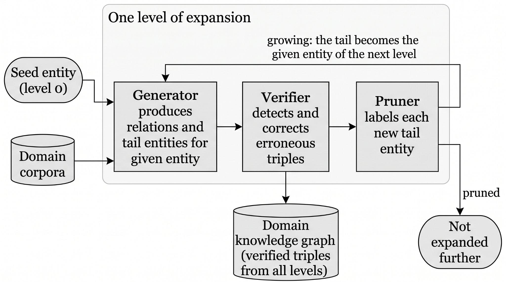

**Figure 2.1.** The SAC-KG construction cycle as described in \[3\]. For a given entity, the Generator produces relations and tail entities from domain corpora; the Verifier detects and corrects erroneous triples; and the Pruner labels each new tail entity as growing or pruned. Growing tails re-enter the Generator as the given entities of the next level, and pruned tails are not expanded further.

## **2.5 Measuring Insertion Cost and Placement Accuracy**

### 2.5.1 Cost Quantities and Gold-Standard Accuracy

The third objective requires measuring, for each strategy and graph size, wall-clock time, LLM API calls, and placement accuracy against an expert-verified gold standard. The cost measures follow from the quantities reported by Funk et al. \[1\] (Section 2.3.1); the accuracy measure rests on the work of Aytekin and Saygın, reviewed here.

**AYTEKIN AND SAYĞIN** \[6\] present ACE, a system for constructing Educational Knowledge Graphs (EKGs) — knowledge graphs specifically representing *prerequisite* relationships among concepts in a learning domain, intended to support student navigation through a subject's dependency structure. Unlike the general-purpose systems discussed above, ACE combines an embedding-based prerequisite-scoring mechanism with a human-expert-in-the-loop verification step: concept pairs are ranked by a computed similarity score, and only the highest-ranked pairs are presented to a human expert for final confirmation, substantially reducing the total number of pairs requiring manual review compared to full manual construction.

Two aspects of this work are especially significant to the present study. First, Aytekin and Saygın \[6\] directly compare their embedding-based scoring approach against zero-shot and retrieval-augmented LLM baselines (GPT-4o-mini, LLaMA 3) on the prerequisite-detection task itself, reporting a clear precision-recall trade-off: their embedding-based approach achieves near-complete recall (100%) but modest precision (46.13%), while LLM-based approaches achieve much higher precision (up to 87.23% with retrieval augmentation) but substantially lower recall (as low as 35.80% in the zero-shot case) — demonstrating that neither embeddings nor LLMs alone are sufficient for reliably identifying prerequisite relationships, a trade-off this study's own comparison of narrowing strategies must be interpreted in light of. Second, and most directly relevant to this study's methodology, Aytekin and Saygın \[6\] publicly released the gold-standard graphs used in their own evaluation — including the Metacademy graph (141 expert-verified concepts from Machine Learning, Statistics, and Linear Algebra) and the DSA graph (29 expert-verified concepts from Data Structures and Algorithms) \[7\] — which this study adopts directly as its source of expert-verified ground truth for measuring insertion placement accuracy, as detailed in Chapter 1's Scope and Limitations and to be further specified in Chapter 3.

### 2.5.2 Evaluating Accuracy and Cost Together

The third objective also requires deciding which strategy performs better, and the reviewed insertion studies give no accepted threshold for this \[1\]–\[4\]. Related evaluation literature supplies the methods instead.

Kapoor et al. \[12\] argue that evaluating systems on accuracy alone hides cost, and that results should be reported as a trade-off between accuracy and cost, with the set of non-dominated systems (the Pareto frontier) as the basis for comparison. Aumüller, Bernhardsson, and Faithfull \[13\] apply the same idea to approximate nearest-neighbour search, comparing algorithms on a recall-versus-speed trade-off rather than on either quantity alone. A system is Pareto-dominated when another is at least as good on every criterion and better on one \[14\]. This study uses dominance as its first, assumption-light comparison.

When a single ordering is wanted, multi-criteria decision methods combine normalised criteria with weights. The weighted-sum model and TOPSIS \[15\] are standard, but Marler and Arora \[16\] show that weights do not directly express importance and that the weighted sum is compensatory: a very good score on one criterion can offset a very poor one. Triantaphyllou and Sánchez \[17\] show that rankings can change with the weights, and Lahdelma, Hokkanen, and Salminen \[18\] respond by examining the whole weight space and reporting how often each alternative takes each rank, instead of relying on one weight vector. To avoid compensation, a minimum level can be set on a criterion before any weighting, which follows the satisficing idea of Simon \[19\]. Such minimum levels should be fixed in advance and justified by context, as is the practice for non-inferiority margins in clinical research \[20\].

These works justify the structure of Section 3.6: minimum-level gates, then dominance, then weighted ranking with a weight-sensitivity check. None of them supplies the threshold values themselves, which are therefore anchored to this study's own pre-fixed criteria and to \[1\], and are stated as conventions. This is an absence claim limited by the scope of the search, as in Section 2.8.

## **2.6 Amortized Complexity and Theoretical Cost Claims**

The fourth objective asks whether the cost of a single insertion under a bucket-capped strategy remains flat as the graph grows, which is the structural premise of the amortized bound proposed in the literature for bounded-bucket insertion. Answering it requires both the analytical vocabulary of amortized analysis and a close look at the one claim of this kind among the reviewed works.

### **2.6.1 Amortized Complexity Analysis**

Originating in an entirely different research tradition, the field of algorithm analysis has long studied how to reason about the cost of operations that modify a data structure repeatedly over time — insertions into a dynamic array, insertions into a self-balancing tree, or updates to a spatial data structure such as a Voronoi diagram. The relevant analytical tool here is *amortized complexity*: rather than analyzing the worst-case cost of a single operation, amortized analysis considers the average cost across a sequence of operations, which often reveals that an occasional expensive operation (such as a data structure resizing itself) is "paid for" by many preceding cheap operations, yielding a favorable average cost overall.

This body of classical analysis is directly relevant to the present study because it supplies the precise vocabulary and proof techniques — accounting arguments, potential-function arguments, and geometric-decay arguments — that would be needed to rigorously establish whether a knowledge-graph insertion strategy's cost is truly bounded as the graph grows, rather than merely observed to be low in a specific experiment.

### **2.6.2 T**he The**oretical Claim of EraRAG and Its Empirical Validation**

The bound of Zhang et al. \[4\] introduced in Section 2.3.4 is of direct and central relevance to the present study for two reasons. First, it is, among all works reviewed, the only one to offer a formal proof of an amortized cost bound specifically for LLM-graph insertion, making it the strongest available theoretical anchor for this study's central research question. Second, and more importantly for motivating this study's contribution, a close reading of EraRAG's own reported experiments reveals that this bound is never empirically validated against the specific variable it claims to be independent of: total pre-existing graph size. Every dynamic-insertion cost experiment reported by the authors holds the pre-existing corpus at a fixed proportion (typically splitting a dataset into a 50% "initial" portion, with the remaining 50% inserted in fixed increments) and varies only the size of the *incoming batch*, never the size of the *graph being inserted into*. The proof itself — while broadly consistent with established amortized-analysis techniques such as those described in Section 2.6.1 — warrants closer scrutiny: the proof's central step — asserting that repeated bucket splits and merges will not cascade without formally invoking a standard amortized-analysis technique such as a potential-function or accounting argument — falls short of the rigor typically expected of such a bound. Importantly, the size-sweep protocol used in this study performs a single insertion per trial after the graph has been constructed (Section 3.4), so its measurements characterize the cost of one un-amortised insertion step at each graph size; they do not test EraRAG's multi-insertion amortized claim itself, only whether the bounded-region premise on which that claim rests holds as the graph grows. In this study, insertion is strictly incremental (Δ = 1) and restricted to a single flat layer, so the corresponding language-model cost is that of the pairwise decision queries over the candidates in one bounded bucket, at most s_max calls.

## **2.7 Reproducible Artifacts and the Research Context**

The fifth objective concerns producing a documented, reproducible experimental artifact that future researchers can extend. Two strands of the literature bear on it: the public release of expert-verified datasets in \[7\], on which this study's artifact builds (Section 2.5), and the state of related research in the Philippine setting in which the artifact is produced.

A structured search of Philippine-affiliated academic output — including general web search, targeted searches of Philippine computing-research venues such as the *International Journal of Computing Sciences Research*, and searches specifically combining Philippine-institutional terms with knowledge-graph and large-language-model terminology — found no Philippine-affiliated study addressing LLM-driven knowledge graph construction, incremental graph insertion, or candidate-narrowing strategies for graph maintenance. This absence is treated here as a finding to be reported honestly rather than a search failure to be concealed: it is corroborated by an independent, unrelated finding reported by Balilo \[8\], whose review of Bicol University's CS/IT capstone submissions from 2011 to 2019 found that approximately 60% of Philippine undergraduate capstone projects in computing take the form of information systems built for a specific organization, suggesting that a purely algorithmic, mechanism-level study such as the present one — with no organizational client or information-system deliverable — represents a genuine minority pattern within the local capstone research tradition, rather than an oversight specific to the knowledge-graph subfield.

**NAGUIO AND ROXAS** \[9\] present a multi-scale graph neural network framework for *knowledge graph completion* — the task of predicting missing relationships within an existing graph — applied specifically to Philippine lexical resources spanning Tagalog, Cebuano, and English, evaluated on a graph of 113,557 words and 304,171 lexical relations. Their approach processes graph neighborhoods at three distinct scales (local morphological patterns, semantic clusters, and cross-lingual relationships) and reports a substantial improvement over baseline methods (76.01% AUC, a 22.90 percentage-point gain).

While methodologically distinct from the present study — Naguio and Roxas address graph neural network-based completion over a fixed, pre-existing node set, rather than LLM-driven placement of newly arriving nodes — this work is conceptually adjacent in an important respect: both studies are concerned with modifying an *already-existing* graph structure efficiently, rather than constructing a graph from scratch. Their multi-scale neighborhood approach (processing candidates at multiple structural distances simultaneously) is also a design pattern worth noting alongside this study's own candidate-narrowing strategies, even though the underlying mechanism (graph neural network message-passing) differs substantially from the embedding-and-LLM-based approaches this study investigates. This study's contribution differs from theirs primarily in its object of measurement: where Naguio and Roxas measure completion accuracy, this study measures insertion *cost* as a function of graph size, a dimension not addressed in their work.

## **2.8 Synthesis**

Table 2.1 summarizes the works reviewed in this chapter according to three dimensions directly relevant to this study's contribution: whether the work addresses incremental (rather than purely batch) graph construction, whether it proposes or evaluates a specific candidate-narrowing mechanism, and whether it empirically measures cost as an explicit function of pre-existing graph size.

**Table 2.1**: Summary of reviewed works by incremental construction, narrowing mechanism, and cost-versus-graph-size measurement.

| **Work** | **Incremental** | **Narrowing mechanism** | **Cost vs. pre-existing size** |
|:---|----|----|----|
| Funk et al. \[1\] | Yes | Top-down/bottom-up search with pruning (adapted from KRIS) | No; aggregate prompts and dollars |
| iText2KG \[2\] | Yes | Cosine-similarity threshold (approx. 0.6) | No; aggregate |
| SAC-KG \[3\] | — | Learned Pruner (continue or stop a branch) | No; aggregate |
| EraRAG \[4\] | Yes | Size-bounded buckets (hyperplane LSH) | No; cost experiments vary incoming batch size only |
| ACE \[6\] | — | Embedding-based pair scoring with expert verification | — |
| Naguio & Roxas \[9\] | No | Multi-scale neighborhood processing (GNN); fixed node set | — |

*Note:* Entries reflect the discussion in this chapter; a dash (—) means the dimension is not addressed in the review of that work. Balilo \[8\] is not tabulated because that study reviews capstone project trends rather than graph construction.

Across the seven works discussed in Sections 2.3 through 2.7, every study that addresses incremental knowledge graph construction proposes and evaluates its own narrowing mechanism in isolation, but none evaluates that mechanism *against* an alternative narrowing mechanism under the same task and measurement conditions \[1\]–\[4\]. Separately, every study that reports a cost or efficiency measurement does so in aggregate — total tokens, total dollars, or total time across an entire experimental run — rather than as an explicit function of the size of the graph being inserted into at the time of insertion \[1\]–\[4\]. This holds even for the one study offering a formal theoretical bound on insertion cost \[4\], whose own empirical validation, as discussed in Section 2.6.2, varies a different variable (incoming batch size) than the one its proof concerns (pre-existing graph size).

A further gap is methodological. None of the reviewed insertion studies states in advance what level of accuracy and cost would make a narrowing strategy adequate, so a claim that one strategy is "better" rests on the author's reading of the results. Section 2.5.2 identifies the evaluation methods (dominance, minimum-level gates, weight-sensitivity analysis) that this study uses to make that judgement explicit.

This chapter's review therefore surfaces two specific, well-evidenced gaps that directly motivate the present study, first identified in Chapter 1 and reinforced here through closer engagement with the primary literature: (1) the absence of any reviewed study empirically measuring insertion cost as a function of pre-existing graph size, and (2) the absence of any reviewed study comparing multiple candidate-narrowing strategies against one another under controlled, identical conditions. It should be stated plainly that this is an absence claim, and absence claims are inherently limited by the scope of the search that produced them; the search conducted for this chapter, while combining multiple search strategies and direct engagement with primary sources, was not an exhaustive systematic review of the kind that would typically require a dedicated methodology of its own (e.g., a PRISMA-style protocol across multiple academic databases). This limitation is noted here in the interest of methodological honesty and is not expected to materially change this study's motivation, given the consistency of the absence across every relevant work independently identified through several distinct search strategies.

## **2.9 Co**nclu**sion**

This chapter reviewed the literature in the order of the study's five specific objectives. For Objective 1, it covered the brute-force baseline and its cost \[1\], embedding-similarity thresholding and its threshold hyperparameter \[2\], the fixed-candidate alternative offered by approximate nearest-neighbor retrieval \[11\], \[12\], and bounded-bucket partitioning \[4\]. For Objective 2, it showed that automated construction has been demonstrated at a very large scale \[3\] without cost being reported as a function of existing graph size. For Objective 3, it established the cost quantities reported in prior work and the expert-verified gold-standard graphs \[6\], \[7\] against which placement accuracy will be measured, and the Pareto, gate-based, and weight-sensitivity methods \[12\]–\[20\] used to judge which strategy performs better. For Objective 4, it identified the structural premise of the amortized bound of EraRAG \[4\], that insertion cost stays bounded as the graph grows, as the claim to be tested, along with the analytical framework for doing so. For Objective 5, it situated the study's reproducible artifact within the public datasets of \[7\] and within the local research context.

Taken together, the review supports the two gaps stated in Section 2.8: insertion cost has not been measured as a function of pre-existing graph size, and candidate-narrowing strategies have not been compared under identical conditions. Chapter 3 describes the methodology by which this study addresses both.

\
=

# **CHA**PTER 3: M**ETHODOLOGY**

## **3.1 Research Design**

This study employs a **developmental, experimental research design**. It does not involve human respondents, surveys, or qualitative interpretation of subjective data; instead, it involves the controlled manipulation of an independent variable (the candidate-narrowing strategy used, and the size of the graph being inserted into) and the measurement of dependent variables (insertion cost and insertion accuracy) under repeatable, controlled conditions. This makes the study's design closer to an **algorithmic benchmark** than to a survey-based or descriptive study, and its methodology is structured accordingly around implementation, experimental procedure, and measurement — rather than around instrument validity, sampling, or respondent demographics.

## **3.2 Data Sources**

### **3.2.1 Gold-Standard Data (Accuracy Measurement)**

As established in Chapter 1's Scope and Limitations, this study uses two publicly released gold-standard educational knowledge graphs from \[6\], \[7\]: the Metacademy graph (141 expert-verified concepts) and the DSA graph (29 expert-verified concepts, spanning core Data Structures and Algorithms topics such as linked lists, trees, graphs, and standard traversal and sorting algorithms).

Direct inspection of the gold-standard dataset files confirms their structure: the DSA dataset file consists of semicolon-delimited triples (source_concept;target_concept;label), while the Metacademy dataset file consists of space-delimited triples (source_concept target_concept label). In both gold-standard files, label is 1 if the target concept is a prerequisite of the source concept (that is, source_concept requires target_concept), and 0 otherwise. In contrast, the repository's ten intermediate example MEKG files adhere to the reverse convention, where concept1;concept2;1 indicates that concept1 is a prerequisite of concept2. Both gold-standard files are structured as exhaustively enumerated pairwise judgment sets — recording an explicit prerequisite/non-prerequisite judgment for nearly every ordered pair of concepts in the graph, rather than listing only the positive edges as a sparse edge list would. This format directly supports this study's evaluation procedure: for any withheld concept, the complete, expert-verified set of true and false prerequisite relationships to every other concept in the graph can be retrieved directly from the file, without requiring any additional inference about missing or implicit relationships.

The files have the following exact shape. The Metacademy file has 19,740 lines (141 × 140 ordered pairs, no self-loops), of which 318 are labelled 1. The DSA file has 841 lines: 840 distinct ordered pairs, including 29 self-loops (all labelled 0) and 54 distinct positive pairs, plus one repeated row (binary_search_tree;recursion;1). Exactly one ordered pair, binary_search_tree;asymptotic_complexity, is missing, although its reverse (asymptotic_complexity;binary_search_tree;0) is present. Because one direction of that pair is unjudged, predictions on it are left out of the standard scores and are counted as false positives in a separate sensitivity variant.

Neither gold graph is transitively reduced. Computing the transitive reduction of the positive edges leaves 40 of the 54 DSA edges and 213 of the 318 Metacademy edges, so 14 (25.9%) and 105 (33.0%) of the positive edges are implied by other positive edges. The decision prompt accordingly accepts indirect prerequisites, asking whether one concept must be understood, directly or indirectly, before the other.

Of the ten example files, the nine that share concepts with the gold graphs agree with the reversed orientation: 171 positive rows fall on pairs that a gold graph also marks as prerequisites in the reversed column order, and none fall on a gold-positive pair in the opposite orientation (the remaining 254 positive rows between gold-graph concepts lie on pairs the gold files label 0). MEKG_with_8_nodes(logic).txt (8 concepts, 15 positive rows) shares no concepts with either gold graph, so its orientation could not be checked against gold.

The evaluation procedure for this data source proceeds as follows. For each experimental trial, one concept is withheld from the gold-standard graph, and the remaining concepts — together with their known pairwise relationships — form the "existing" graph into which the withheld concept is re-inserted using each of the four narrowing strategies (Section 3.3) in turn. Each strategy's resulting placement (the set of relationships it establishes between the withheld concept and the existing graph) is then compared against the complete, expert-verified row of true labels for that concept, allowing precision and recall to be computed directly: a true positive is a relationship the strategy correctly identifies as a prerequisite; a false positive is a relationship the strategy incorrectly identifies as a prerequisite; a false negative is a true prerequisite relationship the strategy fails to identify. This withhold-and-reinsert procedure is repeated across multiple withheld concepts to obtain a stable average accuracy measurement per strategy, per graph size.

### **3.2.2 Synthetic/Unlabeled Data (Cost-Scaling Measurement)**

To extend the cost-scaling measurements beyond the ceiling of the largest available gold-standard graph, this study draws on two complementary sources, neither of which requires expert-verified ground truth, since — as established in Chapter 1 — cost metrics (wall-clock time, LLM API call count) can be measured objectively regardless of whether the "correct" graph structure is known.

First, at the smaller-to-mid range of the size sweep, this study reuses the smaller example concept maps released in the same dataset repository as the primary gold-standard graphs \[7\] — specifically the ten intermediate-sized example MEKG files spanning 6, 7, 8, 10, 18, 21, and 35 concepts (MEKG_with_6_nodes(DS).txt, MEKG_with7nodes.txt, MEKG_with_8_nodes(DS3).txt, MEKG_with_8_nodes(DS4).txt, MEKG_with_8_nodes(logic).txt, MEKG_with_10_nodes(DS1).txt, MEKG_with_10_nodes(DS2).txt, MEKG_with_18_nodes(ML).txt, MEKG_with_21_nodes(ML).txt, and MEKG_with_35_nodes(ML1).txt), drawn from the Machine Learning, Data Structures, and Logic domains. Reusing these graphs, rather than generating entirely synthetic data at these sizes, allows this portion of the size sweep to rely on real concept data from the same trusted source as this study's primary evaluation set.

Second, to reach the larger graph sizes required by the full size sweep established in Chapter 1 (up to approximately 2,000 nodes) — beyond what any released real dataset in \[7\] provides — a pool of computer-science concept names was generated with an LLM, as described below. It is explicitly acknowledged that these larger synthetic sets are not independently verified for internal correctness or pedagogical validity, and are therefore used exclusively for the cost-scaling dimension of the experiment (Research Question 1); they are not used for the accuracy dimension (Research Question 2), which relies solely on the expert-verified gold-standard data described in Section 3.2.1.

The pool (data/synthetic/cs_concept_names.json, SHA-256 ad26b510…3487) was generated with Claude Sonnet 5 at low effort in headed browser windows; the interface labelled the model "Sonnet 5 Low" on all 73 calls. Thinking was requested off on every call, but the state actually in effect on each call was not recorded. Temperature and maximum output length cannot be set through the interface, and it reports no token usage. Account-level memory was off and no custom instructions were set, as checked by hand rather than by tooling. The adapter extracted each response from the page and post-processed it (HTML to markdown, with typographic quotation marks normalized to ASCII), so the stored text is not a verbatim copy of the clipboard.

Generation covered 80 computer-science subfields (for example algorithms, data structures, operating systems, and distributed systems), with one call per subfield requesting 40 lowercase snake_case concept names of one to four words. Three parallel shards, each on one fixed browser profile with no profile changes or restarts, each stopped once its own cache held 867 valid names. As a result 73 of the 80 subfields were queried (24, 25, and 24 calls per shard, 22.9 minutes of wall time, a mean of 46.4 s per call); the seven never reached, all near the end of the list, are not represented.

The calls returned 2,922 names. Validation required lowercase ASCII snake_case of one to five words (the prompt asked for one to four; three retained names have five), and 2 names failed; 95 matched a concept in one of the 12 evaluation corpora (191 concepts in total) and were removed, with no further overlap in an embedding-form check; 542 exact duplicates (largely cross-shard overlap between related subfields) and 29 singular/plural pairs (irregular plurals are not detected) were removed. This leaves 2,254 unique names (2,922 − 2 − 95 − 542 − 29), above the 2,100 minimum fixed before the run and the 2,001 the sweep needs, but below the 2,600 target because each shard stops on its own count before cross-shard de-duplication, so the pool differs from what a sequential run would have produced.

A manual check of the stored responses found that all parse as JSON arrays of strings, each prompt names its own subfield, and the opening names of every response are on topic, with no sign of cross-talk between shards (this does not rule out faults in how prompts were entered). The names are not verified for pedagogical validity. The generator belongs to a different model family from the decision-step model (Section 3.3.6), which reduces but does not eliminate shared-vocabulary bias. The per-call raw responses are kept alongside the pool.

## **3.3 System Architecture and Implementation**

### **3.3.1 Overview of the Experimental Pipeline**

The experimental system consists of four independently implemented **candidate-narrowing strategies**, each of which performs the same fundamental task — given an existing knowledge graph and one new candidate concept, decide how (or whether) that concept connects to the existing graph — using a different underlying mechanism. All four strategies share the same final decision-making step (an LLM call that determines the precise relationship between the new concept and a shortlisted set of candidates); they differ only in *how that shortlist is produced*, which is the specific variable this study investigates. Figure 3.1 gives an overview of this pipeline for a single insertion.

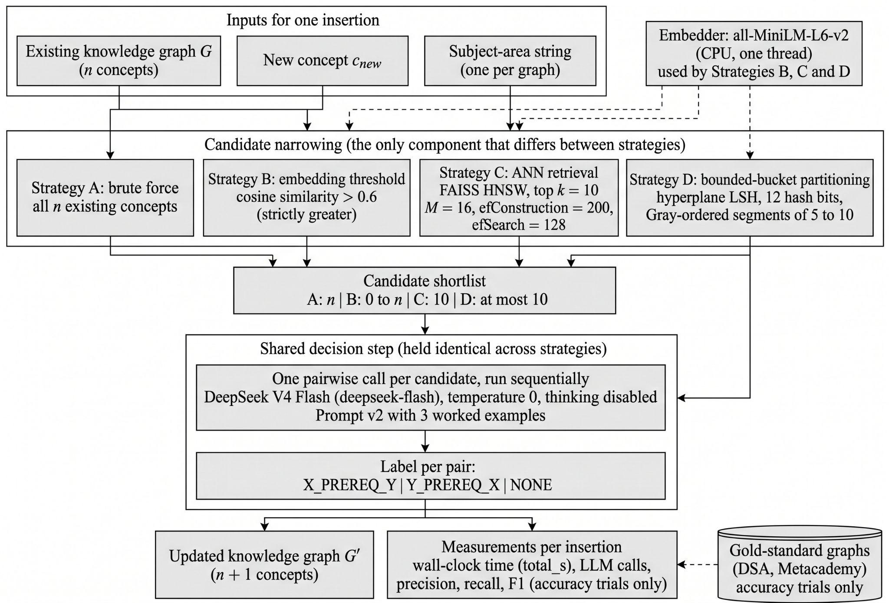

**Figure 3.1.** Experimental pipeline for a single insertion. Each strategy narrows the existing graph to a candidate shortlist by a different mechanism; the shortlist is then passed to an identical decision step, so that any difference in the measured outputs is attributable to the narrowing mechanism alone.

### **3.3.2 Strategy A: Brute-Force Comparison**

This strategy serves as the study's control condition. For a new candidate concept, the system queries an LLM to determine whether a relationship exists between the new concept and *every single existing node* in the graph, one at a time. No narrowing or filtering occurs before this stage. This mirrors the approach explicitly identified as impractical at scale in \[1\], and its cost is expected to grow directly, without bound, as the graph grows — providing the reference curve against which the other three strategies are compared.

### **3.3.3 Strategy B: Embedding-Similarity Thresholding**

This strategy first computes a vector embedding for the new candidate concept, then computes cosine similarity between this embedding and the pre-computed embeddings of every existing node in the graph. Only nodes whose similarity strictly exceeds a fixed threshold are shortlisted for the final LLM decision step. Following the precedent established in \[2\], the threshold is fixed a priori at θ = 0.6 before any experimental run and is not tuned on this study's evaluation data; this keeps the shortlist rule from being adjusted after seeing results. To show how sensitive the findings are to this choice, the threshold is additionally evaluated at θ ∈ {0.4, 0.5} as separate sensitivity runs (Section 3.4). Similarity is computed as cosine similarity between embeddings produced by the all-MiniLM-L6-v2 sentence-embedding model run locally on CPU with PyTorch restricted to a single thread (a setting applied to every embedding-based strategy so that their embedding times are comparable), and the shortlist may be empty, in which case no LLM call is made for that insertion. Because Strategy B does not cap candidate shortlists, an insertion may shortlist up to n existing nodes if their similarity exceeds the threshold (yielding a worst-case planned bound of up to 38,500 LLM calls across the sweep matrix and 5,012 calls in accuracy mode). Realised calls depend on how many existing concepts exceed θ, are not known before the run, and for the lower θ values may approach the brute-force count.

### **3.3.4 Strategy C: Approximate Nearest-Neighbor (ANN) Retrieval**

This strategy also relies on vector embeddings, but rather than filtering by a fixed similarity *value* (as in Strategy B), it retrieves a fixed *number* of the most similar existing nodes using an approximate nearest-neighbor index. This study implements this strategy using FAISS, a widely used open-source library for efficient similarity search, configured to retrieve the top-*k* most similar existing nodes, with *k* = 10 fixed a priori before any experimental run and not tuned on this study's evaluation data. The same embeddings and cosine similarity as Strategy B are used (inner product on L2-normalised vectors), so that Strategies B and C differ only in how candidates are selected from the same similarity scores. The index is a FAISS hierarchical navigable small-world (HNSW) graph with M = 16 links per node, construction depth efConstruction = 200, and search depth efSearch = 128, all fixed in advance and not tuned on the evaluation corpora. These values differ from FAISS library defaults (which in FAISS 1.15.1 default to efConstruction = 40 and efSearch = 16). The index is built and queried single-threaded (via FAISS thread controls) so that repeated runs produce identical, deterministic results without altering vector search complexity. Because the index is approximate, it can occasionally miss a node that an exact search would have returned. For every insertion, the study therefore also records the fraction of the returned candidates that belong to the exact top-*k* set (exact_topk_overlap), computed outside the timed measurement. This separates loss caused by the approximate index from loss caused by the embedding itself ranking a relevant concept below the top *k*.

This strategy is structurally distinct from Strategy B because it does not depend on selecting a similarity threshold. It is not free of tunable parameters, however: *k* and the index settings above remain design choices. Sensitivity runs vary *k* ∈ {5, 20} (with planned call bounds of 300 and 1,200 over the sweep matrix; 295 and 1,180 in accuracy mode) and efSearch ∈ {64, 256} one at a time around the primary configuration (Section 3.4), where planned call bounds depend strictly on *k* and are independent of efSearch. The choice of primary efSearch = 128 and sensitivity variants {64, 256} was calibrated before any evaluation corpus was run, using benchmarks on randomly generated vectors rather than on the study's evaluation data: on 384-dimensional isotropic Gaussian vectors (n = 2000, M = 16, efConstruction = 200), mean recall@10 against exact search was 0.841 at efSearch = 64, 0.968 at efSearch = 128, and 0.999 at efSearch = 256 (near-converged reference), while clustered random vectors achieved a recall of at least 0.999 in every evaluated setting. These figures come from random-vector benchmarks; MiniLM recall on domain concept embeddings is unmeasured prior to execution and is monitored at runtime via exact_topk_overlap. This directly addresses the open concern raised in \[2\] about threshold selection, by replacing a value-based cutoff with a count-based one whose effect is measured rather than assumed.

### **3.3.5 Strategy D: Bounded-Bucket Partitioning**

This strategy organizes existing nodes into size-bounded groups ("buckets" or "segments"), such that inserting a new node only ever requires comparing it against the members of one bounded bucket, rather than the whole graph. This study's implementation adapts the size-bounded hyperplane-LSH partitioning principle described in \[4\] to the concept-node insertion task, rather than reproducing EraRAG's own multi-layer text-chunk summarization architecture directly. Specifically, EraRAG's paper provides the structural foundation of hyperplane-LSH partitioning and the \[s_min, s_max\] split and merge lifecycle, but leaves several concrete data-structural choices unspecified (it does not specify oversize-split or merge-adjacency ordering). To complete the operational specification, this study implements a deterministic 1D linearisation: hash codes are mapped to an integer Gray-curve sequence, existing concepts are grouped into contiguous intervals ("segments") along this curve, oversize segments are split via midpoint bisection (len // 2), and undersize segments (fewer than s_min entries) are merged into an adjacent neighbour chosen lexicographically by (Hamming distance between the touching endpoint codes, Gray-rank gap between them, neighbour size, left before right), so that neighbour size only breaks ties between neighbours that are equally close in code and Gray rank.

The primary parameters are fixed a priori before experimental execution: lower segment bound s_min = 5, upper segment bound s_max = 10, hash bit count n_bits = 12, and random hyperplane seed fixed to 42 (matching the experiment harness default seed). The choice of n_bits = 12 is justified strictly by code space: 2^12 = 4,096 possible codes comfortably exceeds the largest evaluated graph size (n = 2,000), ensuring the hash space does not artificially saturate, rather than by tuning retrieval quality. The constraint s_max \>= 2 \* s_min is a chosen convention to maintain post-split headroom. Sensitivity runs examine parameter variations one at a time: (s_min, s_max) ∈ {(2, 5), (10, 20)} with n_bits = 12 and seed 42 held constant (Section 3.4).

Because a new concept is compared only against existing concepts in its assigned home segment, the candidate shortlist size is bounded by s_max = 10. Over the 60-trial sweep matrix (6 sizes × 10 trials), the planned upper bound on LLM calls is 600 calls (300 calls for sensitivity setting (2, 5) and 1,200 calls for (10, 20); in accuracy mode, 590, 295, and 1,180 calls). Because no segment exceeds s_max entries, the candidate shortlist cannot exceed s_max, and realised call counts are measured empirically rather than assumed. Equal worst-case bounds between Strategy C (k = 10) and Strategy D (s_max = 10) mean the comparison does not isolate partitioning geometry from shortlist capacity.

Two methodological limitations of this formulation should be noted. First, the size-sweep benchmark performs a single insertion per trial after the graph is initialized with setup(); it therefore measures the time and LLM-call cost of one un-amortised insertion step and does not simulate sequential multi-insertion streams to evaluate the amortized bound in \[4\]. Second, the random hyperplane orientation is fixed by seed 42 and not varied across draws. Separately, for every insertion the study records the overlap between the shortlist and the exact top-10 nearest neighbours (exact_topk_overlap) as a diagnostic of how closely the bounded segment tracks the nearest-neighbour set; no value is assumed in advance.

### 3.3.6 The Shared Decision Step

Across all four strategies, once a shortlist of candidate existing nodes has been produced, a single shared mechanism determines the final relationships: for each shortlisted candidate, an LLM is asked for a directed prerequisite judgement on the pair formed by the new concept and that candidate. There is one call per candidate, with no batching, and calls are strictly sequential (concurrency 1) so that per-call latency is not distorted by the client's own load. The answer is one of three labels: the new concept is a prerequisite of the candidate, the candidate is a prerequisite of the new concept, or neither. No other relation types are predicted, matching the gold-standard graphs of Section 3.2.1. This shared step is held constant across all four strategies specifically so that any measured difference in cost or accuracy can be attributed to the *narrowing mechanism* rather than to differences in how the final decision is made — this is the controlled variable that makes the four-strategy comparison methodologically valid.

Each prompt carries only the two concept names, with file suffixes removed and underscores shown as spaces, and one subject-area string fixed for the graph being processed (for example, "data structures and algorithms" for the DSA graph); the subject-area line is omitted when no string is set. No definitions, source text, or neighbourhood information is supplied. The decision model is DeepSeek V3, queried via DeepSeek's official API under the alias deepseek-flash (resolving to deepseek-chat), operating at temperature 0 with thinking disabled, producing deterministic prerequisite labels, so no reasoning tokens are produced. Responses echo only the alias; no internal version or dated snapshot is observable. Timed runs are scheduled outside DeepSeek's peak window (01:00–04:00 and 06:00–10:00 UTC, Monday to Friday, excluding Chinese public holidays).

The decision prompt (version v2, held fixed throughout) is reproduced below. The system prompt, which includes three worked examples, is:

You judge prerequisite relationships between concepts in a curriculum. A concept P is a prerequisite of a concept Q if a learner needs to understand P, directly or indirectly through other concepts, before learning Q. Answer with exactly one of: X_PREREQ_Y (X is a prerequisite of Y), Y_PREREQ_X (Y is a prerequisite of X), NONE (neither). Output only that token.

Examples:

Concept X: fractions / Concept Y: ratios -\> X_PREREQ_Y

Concept X: calculus / Concept Y: limits -\> Y_PREREQ_X

Concept X: poetry / Concept Y: plumbing -\> NONE

The user prompt for each pair is the following, where X is always the newly inserted concept and Y the candidate:

Subject area: \<subject area\>

Concept X: \<new concept\>

Concept Y: \<candidate concept\>

A response is trimmed and upper-cased and accepted only if it equals one of the three labels. Under the default policy an unparseable response contributes no edge and is recorded as a parse failure; none occurred in the pilot described below.

The prompt was chosen after pre-testing on a small number of probes. A zero-shot version (v1) answered "X is a prerequisite of Y" on all six DSA probe pairs and on 12 of 16 pairs of a balanced general-education set; a variant with the option order reversed instead answered "Y is a prerequisite of X" on 11 of 16, which is consistent with a position bias. The six DSA probe pairs were therefore seen before v2 was chosen. Version v2 adds three balanced worked examples (fractions/ratios, calculus/limits, poetry/plumbing), none of whose concepts appears in the 12 evaluation corpora; it was selected using only pairs from outside the DSA and Metacademy graphs and answered all 16 pairs of the balanced set correctly.

To establish the accuracy that bare-name prompting can reach before the strategies are compared, a leave-one-out brute-force pilot was run on the 29 DSA concepts (812 decisions, each inserted concept paired with the 28 others; run 20261007_053743Z). Protocol validity passed all criteria: no transport or parse failures, no retries, no reasoning tokens, and a single observed model identifier. The acceptance criteria were fixed before the pilot: a pass required micro recall of at least 0.70, micro F1 of at least 0.50, and a direction-flip rate of at most 15%. The pilot gave micro F1 0.541 (met), micro recall 0.611 (below the pass threshold but above the fail threshold of 0.50), micro precision 0.485, and a direction-flip rate of 15.38% (12 of 78 predicted edges on gold-positive pairs pointed the wrong way); swap consistency was 85.71%. The verdict was therefore conditional: prompt v2 was kept unchanged as the shared decision step, and no further tuning against DSA is permitted. Post hoc, 34 of the 58 false positives on pairs the gold labels 0 are implied by the transitive closure of the DSA gold graph, so precision is understated; the verdict is unchanged.

## **3.4 Experimental Procedure**

For each of the four candidate-narrowing strategies described in Section 3.3, and for each graph size in the log-spaced progression established in Chapter 1 (n = 50, 100, 200, 500, 1000, 2000, supplemented at the smaller end by the DSA graph's 29-node scale and Metacademy's 141-node scale where gold-standard evaluation is required), the following procedure is executed:

1.  **Graph preparation.** An existing graph of the target size is assembled — for the gold-standard accuracy trials, by withholding one or more concepts from the Metacademy or DSA graph as described in Section 3.2.1; for the cost-scaling trials, from the synthetic/unlabeled data source described in Section 3.2.2.

2.  **Insertion.** One new candidate concept is inserted into the existing graph using the strategy under test, following that strategy's specific procedure as detailed in Sections 3.3.2 through 3.3.5, culminating in the shared LLM decision step described in Section 3.3.6.

3.  **Measurement.** For this single insertion, the following are recorded: wall-clock time elapsed from the start of the narrowing step to the completion of the final decision step; the total number of LLM API calls made during the insertion; and, where gold-standard data is available, the precision, recall and F1 of the resulting placement and the recall of the shortlist, as defined below.

4.  **Repetition.** Steps 1–3 are repeated across multiple independently withheld or generated concepts at each graph size, to obtain a stable average measurement per strategy per size, rather than relying on the outcome of a single insertion.

**Metric definitions.** Wall-clock time per insertion is total_s = shortlist_s + decide_s + apply_s + update_s, where shortlist_s includes embedding the new concept for the embedding-based strategies and decide_s is the time spent in the LLM decision step; the harness's own invariant checks are timed separately (validate_s) and are not part of total_s. LLM calls are counted per candidate, one per shortlisted candidate. For accuracy trials, a predicted edge is a true positive only if the gold graph contains that edge in the predicted direction; any other predicted edge is a false positive (an edge predicted in the reverse of a gold edge is therefore both a false positive and, because the gold edge goes unpredicted, a false negative); and every gold edge incident to the inserted concept that is not predicted is a false negative. Shortlist recall is the fraction of the inserted concept's gold neighbours (concepts joined to it by a gold edge in either direction) that appear in the shortlist, so it measures what narrowing discards before the decision step; it is undefined for a concept with no gold neighbours. Precision, recall and F1 are reported both pooled over all trials (micro) and as the unweighted mean of per-concept values (macro), leaving out concepts for which a value is undefined. For a baseline that draws min(*k*, *m*) distinct existing concepts uniformly at random from the *m* concepts already in the graph, the expected shortlist recall is min(*k*, *m*)/*m*.

**Parameter fixing and sensitivity.** The parameters of Strategies B, C, and D (the similarity threshold θ, the shortlist size *k*, the HNSW index settings, and the bucket-size bounds) are fixed a priori before experimental execution and are not adjusted using the Metacademy, DSA, or synthetic evaluation data. Their effect is examined only through pre-specified one-at-a-time sensitivity runs around the primary configurations (θ = 0.6; *k* = 10 with efSearch = 128; bucket bounds (s_min, s_max) = (5, 10) with 12 hash bits and seed 42): θ ∈ {0.4, 0.5} for Strategy B; *k* ∈ {5, 20} and efSearch ∈ {64, 256} for Strategy C; and (s_min, s_max) ∈ {(2, 5), (10, 20)} for Strategy D. Each sensitivity setting is run and reported separately from the primary configuration. For brute force the cost bound is determined directly by graph size n; Strategy B is uncapped and may shortlist up to n existing concepts if similarities exceed θ (up to 38,500 calls across the sweep matrix and 5,012 calls in accuracy mode); for Strategy C the number of LLM calls per insertion cannot exceed *k*, adding at most 10 trials × 6 sizes × *k* calls (600 for *k* = 10, including each efSearch variant; 300 for *k* = 5; 1,200 for *k* = 20), independent of efSearch. The same planned upper bounds apply to Strategy D with s_max in place of *k* (600, 300, and 1,200 calls for s_max = 10, 5, and 20 over the sweep matrix; 590, 295, and 1,180 calls in accuracy mode); because bucket sizes lie between s_min and s_max, candidate counts are at most s_max and realised counts are measured experimentally.

This procedure is executed independently for each of the four strategies at each graph size, yielding, for every (strategy, graph size) pair, an average wall-clock time, an average LLM call count, and — where applicable — an average precision and recall. These results form the basis of the cost-scaling and accuracy-scaling curves that directly answer this study's four research questions as stated in Chapter 1, Section 1.2.

## **3.5 Data Analysis**

The primary analytical method of this study is the visual and statistical comparison of scaling curves: for each strategy, wall-clock time and LLM call count are plotted against graph size, allowing direct visual inspection of whether cost grows linearly, sub-linearly, or remains effectively flat as the graph scales — the specific empirical question motivating this study, as established in Chapter 1's Statement of the Problem. Where a strategy's underlying literature makes an explicit claim about its scaling behavior (most notably the bucket-based bound proposed in \[4\]), the observed curve is used only to check whether the premise of that claim, that the cost of an insertion stays bounded and does not grow with the graph, is consistent with the measurements, addressing Research Question 4. Because every trial for all four strategies performs a single insertion after the graph is constructed, these curves describe the cost of one un-amortised insertion step and do not test amortized behavior over a sequence of insertions.

Placement accuracy (precision and recall, as defined in Section 3.2.1) is analyzed similarly, plotted against graph size for each strategy, to determine whether accuracy degrades, remains stable, or improves as the graph grows — directly addressing Research Question 2. Finally, the four strategies' cost and accuracy curves are compared side-by-side at each common graph size, directly addressing Research Question 3 and this study's General Objective as stated in Chapter 1. The judgement of which strategy performs better follows the decision and ranking framework of Section 3.6 and does not rest on visual reading of the curves.

## 3.6 Decision and Ranking Framework (Post hoc)

### 3.6.1 Status

This framework was specified after the measurements of Chapter 4 were available. It adds no measurement and replaces no pre-registered result. Its criteria and weights are fixed in the decision log before the ranks are computed and are not changed afterwards. It is applied to single-run measurements, so its outputs are classifications of these measurements and not statistical tests.

### 3.6.2 Gates and Classes

Each strategy's primary configuration is checked against three gates, using values already defined in this study.

- **G1, beats chance.** Shortlist recall exceeds the pre-registered random baseline min(k, m)/m (Section 3.4) on every corpus. It is not assessable for a strategy with no shortlist cap (Strategy B, whose shortlist size varies) and not applicable to brute force, whose shortlist is the whole graph.

- **G2, practical cost.** Mean LLM calls per insertion at n = 2000 do not exceed 50. The value comes from the 22 to 50 prompts per inserted concept reported by Funk et al. \[1\]. It is a reference point from a different task and algorithm and not a standard.

- **G3, not dominated.** The strategy is not Pareto-dominated, on calls and micro-F1, on either corpus (Figure 4.9, Table 4.6), with the study's 0.025 F1 margin applied as in Section 4.4.

A strategy is **Effective** if it passes every gate and G1 is assessable, **Conditionally effective** if it passes every assessable gate but G1 is not assessable, and **Not effective** if it fails any assessable gate. Section 4.4.1 reports how far the classes depend on the 50-call limit of G2, on the choice of random baseline in G1, and on the dominance margin in G3.

Absolute accuracy is reported separately and is not part of the class. The pilot of Section 3.3.6 fixed acceptance criteria before the strategies were compared: micro-F1 of at least 0.50 and micro recall of at least 0.70 to pass, and micro recall below 0.50 to fail. They were set for brute force on DSA, so they are applied to the other cells only as a reference. Aytekin and Saygın's \[6\] published recall and precision figures on the same gold graphs are cited as context only, because their protocol differs.

### 3.6.3 Ranking

For each corpus separately, the four strategies are ranked on three single criteria: micro-F1, mean LLM calls, and mean wall-clock time per insertion at n = 2000 (sweep runs). No pooled score across corpora is computed, because the corpora differ in domain and density.

For the weighted score, micro-F1 is min-max normalised across the four strategies. Cost is the base-10 logarithm of one plus the mean calls (accuracy-run calls, matched to each corpus), min-max normalised and reversed so that higher is better. The logarithm is used because calls span three orders of magnitude and linear scaling would let brute force flatten the other three. Calls are the cost criterion. Wall-clock time is not weighted alongside them, because time follows calls (Section 4.2.3) and weighting both would count the same cost twice. The scores are recomputed with wall-clock time in place of calls as a check.

Three weight scenarios are declared: accuracy-first (0.7 accuracy, 0.3 cost), balanced (0.5, 0.5) and cost-first (0.3, 0.7). To avoid dependence on any one scenario, the accuracy weight is also drawn uniformly from 0 to 1 (cost weight is its complement), with 20,000 draws and seed 42, and the share of draws in which each strategy takes each rank is reported \[18\]. TOPSIS \[15\] is computed as a cross-check, with Kendall's τ between its ranking and the weighted-sum ranking.

**Score definitions.** For one corpus, let F1_i be the micro-F1 of strategy i and calls_i its mean LLM calls per insertion, both from the accuracy runs (Table 4.4), and let g_i = log10(1 + calls_i). The normalised accuracy score A_i and the normalised cost score C_i use min-max scaling \[21\], and the weighted score S_i is the weighted-sum model \[16\]:

$`A_{i} = \ \frac{{F1}_{i}\  - \ \min_{j}{\ F1}_{j}}{\max_{j}{\ F1}_{j}\  - \ \min_{j}{\ F1}_{j}}`$ , $`C_{i} = \ 1\  - \ \frac{g_{i}\  - \ \min_{j}{\ g}_{j}}{\max_{j}{\ g}_{j}\  - \ \min_{j}{\ g}_{j}}`$

$`S_{i}\ (w)\  = \ w\ A_{i}\  + \ (1\  - \ w)\ C_{i}`$$``$

Here w is the weight on accuracy, 0 ≤ w ≤ 1, and 1 − w is the weight on cost. A criterion on which all four strategies are equal would be set to 0.5 for every strategy; this does not occur in these data.

**Which runs supply which values.** Accuracy and the calls used in the score come from the accuracy runs, matched to each corpus. Gate G2 uses the sweep runs at n = 2000 instead. In the check that replaces calls with wall-clock time, g_i is log10(1 + mean wall-clock seconds at n = 2000) from the sweep runs. This value is the same for both corpora, because accuracy-run latencies are not used for any cost claim (Section 4.6).

**Ties.** Strategies with equal scores in a scenario share the mean of the ranks they occupy (a two-way tie for first is reported as 1.5 each) and are shown as tied, as is usual in rank correlation \[22\]. In the weight sweep the accuracy weight is continuous, so a tie in a single draw has probability zero unless two strategies have identical scores at both ends of the weight range; none do, so every draw gives a strict ranking.

**Weight sweep.** As in \[18\], the accuracy weight is drawn uniformly from 0 to 1 with NumPy's default generator seeded with 42, the harness default seed (numpy.random.default_rng(42)), taking one array of 20,000 uniform draws per corpus and re-seeding for each corpus so that both corpora see the same draws. The rank shares are Monte Carlo estimates with a standard error of at most 0.004 (the square root of 0.25 / 20,000 is about 0.0035). They are rounded to two decimals, so a row may not sum to exactly 1.00. The shares were also computed exactly, because each score is piecewise linear in w and the ranking changes only where two lines cross; the exact and Monte Carlo shares differ by at most 0.005 in any cell (0.0046 on DSA, 0.0022 on Metacademy).

**TOPSIS.** The decision matrix is the pair (A_i, C_i) for each strategy, which is already on a common 0 to 1 scale, so no further normalisation is applied. Each criterion is multiplied by its scenario weight, giving v_i = (w A_i, (1 − w) C_i). The ideal point is (w, 1 − w) and the anti-ideal point is (0, 0), which are the unweighted points (1, 1) and (0, 0) after the same weighting. Closeness is d⁻ / (d⁺ + d⁻) \[15\], where d⁺ and d⁻ are the Euclidean distances to the ideal and anti-ideal points, and strategies are ranked by closeness. Kendall's τ \[22\] compares the TOPSIS ranking with the weighted-sum ranking for each corpus and scenario, using τ-b where the weighted-sum ranking has ties.

**What is a convention.** The log transform of calls, the gate rules and classes of Section 3.6.2, and the three weight scenarios are choices made by the author and are not taken from a published standard. The transform is justified by the range of the calls, the gates are anchored as stated in Sections 3.6.2 and 2.5.2, and the weight sweep is included so that no conclusion rests on one scenario.

Two limits apply. Min-max normalisation depends on the set of four strategies, so adding or removing a strategy can change the scores. The weighted sum is compensatory \[16\], which is why the gates come first.

# Chapter 4: Presentation, Analysis, and Interpretation of Data

## 4.1 Overview and Reporting Conventions

This chapter presents the measurements collected under the experimental procedure of Chapter 3 and interprets them against the four research questions of Section 1.2. Section 4.2 reports cost scaling (Research Question 1), Section 4.3 reports placement accuracy (Research Question 2), Section 4.4 compares the four strategies on both measures (Research Question 3), and Section 4.5 examines whether the cost of one insertion under the bucket-capped strategy stays flat as the graph grows (Research Question 4). Section 4.6 sets out the limits of these results and Section 4.7 summarises them.

**Data collected.** The study comprises 24 runs: 12 accuracy-mode runs and 12 size-sweep runs, one run per configuration. The 12 configurations are the four primary strategy settings plus eight one-at-a-time sensitivity settings (Strategy 2 at \$\theta = 0.4\$ and \$0.5\$; Strategy 3 at \$k = 5\$ and \$20\$ and at \$\text{efSearch} = 64\$ and \$256\$; Strategy 4 at \$(\text{s_min}, \text{s_max}) = (2, 5)\$ and \$(10, 20)\$). Each accuracy run has 59 trials (29 on the DSA graph and 30 on the Metacademy graph); each sweep run has 60 trials (10 at each of \$n = 50, 100, 200, 500, 1000, 2000\$). All 24 runs passed the validation gate: 20 passed outright and 4 passed as resumed runs (accuracy brute force, and sweep brute force, bounded bucket \$(10, 20)\$ and embedding threshold at \$\theta = 0.5\$), and no trial remained failed in any run (Table T3). Accuracy runs were executed at commit 3323bfb and sweep runs at commit ad81414; the two commits are accepted under Amendment 2 of the analysis plan because the source files that affect results were unchanged between them. Tables and figures were generated at commit 554bde3 by a single script from data that had passed the gate, and an independent consistency check of the generated tables and figure data (3,399 checks) reported no failures.

**Statistics.** Cost and accuracy are described, not tested. For each strategy and size the chapter gives the mean (the headline wall-clock statistic, D6) with the median alongside, and 95% percentile bootstrap intervals over trials (10,000 resamples, fixed seed, D1). No hypothesis test is run between strategies, because each configuration is a single run, the decision-step model is not fully deterministic, and 10 trials per size is small. As one indication of run-to-run variation, two runs of the same DSA configuration differed by 0.025 micro-F1 (0.4859 against 0.5111); this is one observed difference, not an estimated noise floor. Scaling is summarised by the slope of an ordinary-least-squares fit of \$\log(\text{mean cost})\$ on \$\log(n)\$ across the six sizes, with a bootstrap interval resampling trials within size. The flatness bins (slope below 0.1 "approximately flat", 0.1 to 0.9 "sub-linear", above 0.9 "approximately linear") are a convention chosen for this study, confirmed for the initial defense and subject to reconciliation with the adviser.

**Pre-registered, post-hoc and exploratory results.** The analysis plan was frozen before any sweep data was opened. Its Disclosure records that the accuracy-mode summaries had already been seen, so accuracy-side choices (per-corpus reporting and the 0.025 labelling margin in Figure 4.9) were not made blind. A first draft of the analysis pipeline was run on the real results before the final pipeline was accepted; the operator's recorded answer (D-88) is that he looked at its output, saw label overlaps, noticed no numbers or results, and requested no change because of it. Three groups of results added after the freeze (Amendment 3) are labelled wherever they appear: (i) slopes that are undefined because a size has zero mean cost, with an exploratory fit on positive-mean sizes; (ii) a timing sensitivity set that excludes retried trials and the single trial launched inside DeepSeek's peak window; (iii) the log-scale companion figures F1b, F2b and F6b. A fourth group is the classification and ranking of Section 4.4.1, which applies the framework of Section 3.6 and was specified after the Chapter 4 results were available. Nothing exploratory or post hoc replaces a pre-registered result. It is recorded in decision D-89 and Amendment 4 of the analysis plan, and its tables and figures are generated by the analysis pipeline (stage --only posthoc).

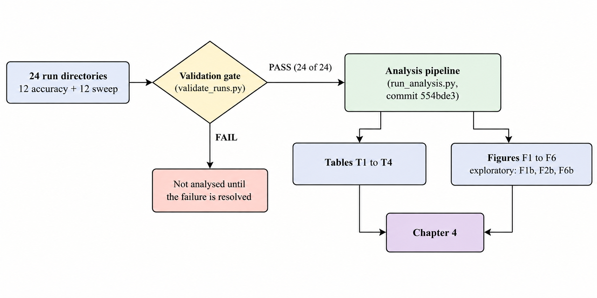

**Figure 4.1.** From run directories to reported results. Only data that passed the gate reaches a table or figure.

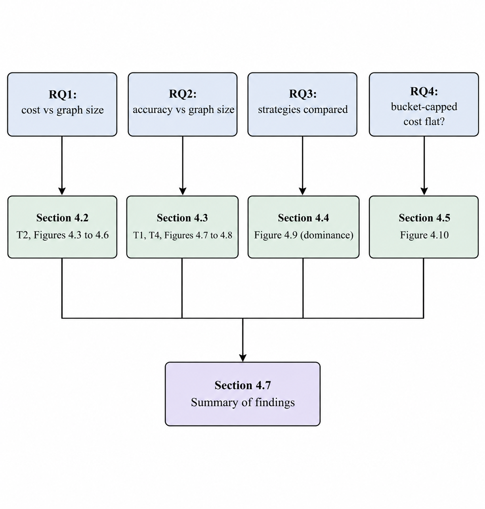

**Figure 4.2**. Map from the research questions to the sections that answer them.

## 4.2 Cost Scaling with Graph Size (Research Question 1)

All cost claims in this section come from the 12 sweep runs on the synthetic concept pool (Section 3.2.2). Each value is a mean over 10 single-insertion trials per size.

### 4.2.1 LLM Calls per Insertion

**Table 4.1:** Mean LLM calls per insertion by graph size (sweep runs).

| **Strategy** | **n = 50** | **100** | **200** | **500** | **1000** | **2000** |
|:---|----|----|----|----|----|----|
| S1 Brute force | 50 | 100 | 200 | 500 | 1000 | 2000 |
| S2 Embedding threshold, θ = 0.6 (primary) | 0.0 | 0.1 | 0.1 | 0.0 | 0.7 | 0.8 |
| S2, θ = 0.5 | 0.0 | 0.3 | 0.6 | 1.3 | 2.5 | 3.0 |
| S2, θ = 0.4 | 0.2 | 0.6 | 1.0 | 4.3 | 7.8 | 13.5 |
| S3 ANN retrieval, k = 10 (primary) | 10 | 10 | 10 | 10 | 10 | 10 |
| S4 Bounded bucket, (5, 10) (primary) | 6.6 | 7.5 | 7.1 | 7.1 | 6.8 | 7.0 |

Strategy 1 makes one call per existing node, so its call count equals n and its log-log slope is 1.0000 (approximately linear). Strategy 3 makes exactly k = 10 calls at every size; its slope is zero and it prints as "0, constant" (the fitted value 6e-32 is floating-point noise on a constant series). Strategy 4's primary configuration averages 6.6 to 7.5 calls at every size, with a fitted slope of −0.0004 (95% CI −0.0433 to 0.0424), approximately flat.

Strategy 2 depends on how many existing nodes exceed the similarity threshold, so its calls grow with n at a low rate. At θ = 0.4 the pre-registered slope is 1.1535 (CI 0.9310 to 1.3880; 8,920 of 10,000 resamples were usable), classified approximately linear, but the level is small: 13.5 calls at n = 2000, about 0.7% of the 2,000 existing nodes, and between 0.4% and 0.9% of n at every size (computed). Slope describes growth rate, not magnitude. At θ = 0.5 and θ = 0.6 the pre-registered fit is **undefined**, because some sizes have zero mean calls (θ = 0.5 at n = 50; θ = 0.6 at n = 50 and n = 500) and a log-log fit needs positive means; the plan forbids clamping. Following Amendment 3 these two cases receive no flatness category. An **exploratory** fit on the positive-mean sizes gives slopes of 0.7966 (CI 0.4482 to 1.2109; 9,666 usable resamples) for θ = 0.5 and 0.8095 (CI 0.2689 to 0.9538; only 4,123 usable resamples) for θ = 0.6. Because the bootstrap conditions on positive draws, these intervals are optimistic in one direction. For θ = 0.6 the counts in Table 4.1 are the evidence; the slope should not be quoted without them.

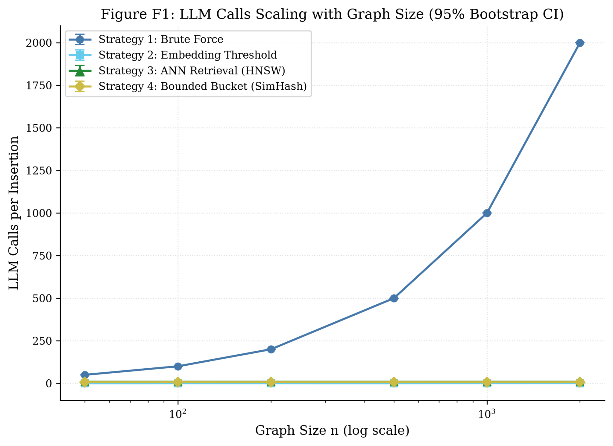

**Figure 4.3.** LLM calls scaling with graph size (95% Bootstrap CI)

### 4.2.2 Wall-Clock Time per Insertion

**Table 4.2:** Mean wall-clock time per insertion (total_s, seconds) by graph size.

| **Strategy**         | **n = 50** | **100** | **200** | **500** | **1000** | **2000** |
|:---------------------|------------|---------|---------|---------|----------|----------|
| S1 Brute force       | 58.63      | 68.43   | 168.35  | 357.57  | 860.11   | 1713.10  |
| S2 θ = 0.6 (primary) | 0.013      | 0.153   | 0.081   | 0.014   | 0.623    | 0.938    |
| S2 θ = 0.5           | 0.012      | 0.319   | 0.390   | 1.471   | 2.167    | 2.843    |
| S2 θ = 0.4           | 0.288      | 0.517   | 0.712   | 9.387   | 6.457    | 11.318   |
| S3 k = 10 (primary)  | 8.476      | 8.673   | 9.461   | 8.497   | 7.912    | 8.277    |
| S4 (5, 10) (primary) | 5.272      | 5.769   | 5.149   | 5.666   | 5.358    | 5.638    |

**Table 4.3:** Log-log slope of mean cost against n (pre-registered unless stated; 95% Bootstrap CI).

| **Strategy (configuration)** | **Calls slope** | **Wall-clock slope** | **Category (wall-clock)** |
|:---|----|----|----|
| S1 | 1.0000 | 0.9605 (0.8472 to 1.0624), R² 0.982 | approximately linear |
| S2 θ = 0.4 | 1.1535 (0.9310 to 1.3880) | 1.0997 (0.8670 to 1.7737) | approximately linear |
| S2 θ = 0.5 | undefined (exploratory 0.7966) | 1.3017 (1.0961 to 1.5963) | approximately linear |
| S2 θ = 0.6 (primary) | undefined (exploratory 0.8095) | 0.8771 (0.5570 to 1.3271), R² 0.461 | sub-linear |
| S3 k = 10 (primary) | 0 (constant) | −0.0201 (−0.0324 to −0.0079) | approximately flat |
| S4 (5, 10) (primary) | −0.0004 (−0.0433 to 0.0424) | 0.0084 (−0.0321 to 0.0488) | approximately flat |

Three readings of Table 4.3 need care. First, Strategy 3's wall-clock interval (−0.0324 to −0.0079) excludes zero, so "approximately flat" holds by the D2 threshold (\|slope\| \< 0.1), not because the interval contains zero; the same is true of its efSearch = 256 (0.0154) and k = 20 (0.0123) variants. The slope has magnitude about 0.02 across a 40-fold increase in n, and the mean fluctuates between 7.9 and 9.5 seconds with no monotone trend. Second, Strategy 2 at θ = 0.6 has a wall-clock R² of only 0.461: most trials make no LLM call and take about 0.01 seconds, while the few that do take about a second each, so the six size means mostly reflect how many trials happened to call. Its "sub-linear" label is a weak description and the means in Table 4.2 are more informative. Third, Strategy 1's all-trials slope (0.9605) lies below 1 partly because of retry delay at n = 50 (Section 4.2.4); a post-hoc set that excludes retried trials gives 1.0558 (CI 1.0439 to 1.0677, R² 0.998). Both support "approximately linear".

At n = 2000 one brute-force insertion takes 1713 seconds on average, against 8.28 seconds for Strategy 3 and 5.64 for Strategy 4, about 207 and 304 times longer (computed).

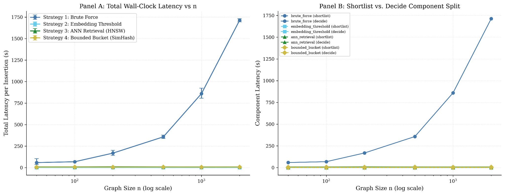

**Figure 4.4.** Wall-clock time per insertion versus graph size (pre-registered F2; Panel A is the total, the second panel splits shortlist and decision time).

### 4.2.3 Time Follows the Number of Calls

The shortlist step (embedding the new concept, the similarity scan, the HNSW search or the hashing) is negligible everywhere: below 0.03 seconds for every Strategy 2, 3 and 4 configuration and below 0.001 seconds for brute force. Wall-clock time is therefore the decision step, and the decision step is the number of calls times the per-call latency. Dividing the mean time at n = 2000 by the mean calls gives 0.857 s per call for Strategy 1 (1713.1 / 2000), 0.828 for Strategy 3 (8.277 / 10), 0.805 for Strategy 4 (5.638 / 7.0) and 0.838 for Strategy 2 at θ = 0.4 (11.318 / 13.5) (computed). The strategies differ in cost almost entirely because they make different numbers of calls, not because their narrowing steps differ in speed.

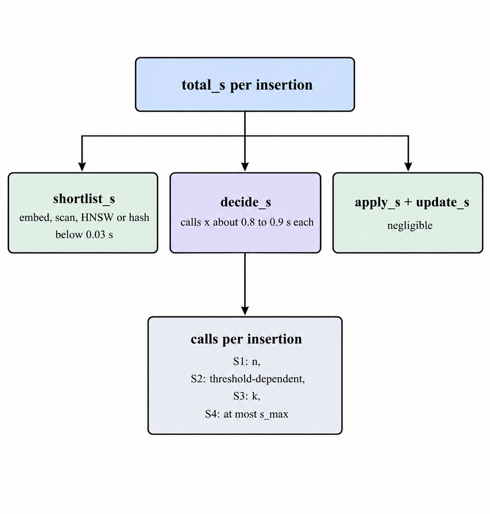

**Figure 4.5.** Where the time of one insertion goes. Per-call latency is similar across strategies, so calls determine cost.

### 4.2.4 Retries and the Peak-Hour Trial (Post-hoc Sensitivity)

total_s includes backoff time for retried trials. Brute force at n = 50 averages 58.63 seconds over all 10 trials but 35.75 seconds when its one retried trial (maximum 264.52 s) is excluded; at n = 200 the values are 168.35 and 156.86 seconds; at n = 2000 they are 1713.10 and 1709.89. Strategy 2 at θ = 0.4 and n = 500 averages 9.39 seconds, or 3.53 seconds without its one retried trial. One sweep trial (sweep:brute_force:2000:t9) was launched with peak hours allowed and ran inside DeepSeek's peak window; the n = 2000 brute-force times range from 1669.5 to 1763.7 seconds (standard deviation 31.7 s), and with ten trials per size no claim is made about an effect of peak hours. Excluding retried trials and that trial changes no flatness category (Strategy 1: 1.0558; Strategy 2 at θ = 0.4: 1.0543 against 1.0997; Strategy 4 at (10, 20): −0.0296 against −0.0193). These runs were also resumed after interruptions, and Strategy 1 and Strategy 2 were first run at sizes 50 to 500 and then extended to all six sizes before analysis, without changing the design (Amendment 3, point 2). Table T3 lists the resumed runs and the counts of failed-then-succeeded trials, none of which is imputed or dropped from the pre-registered results.

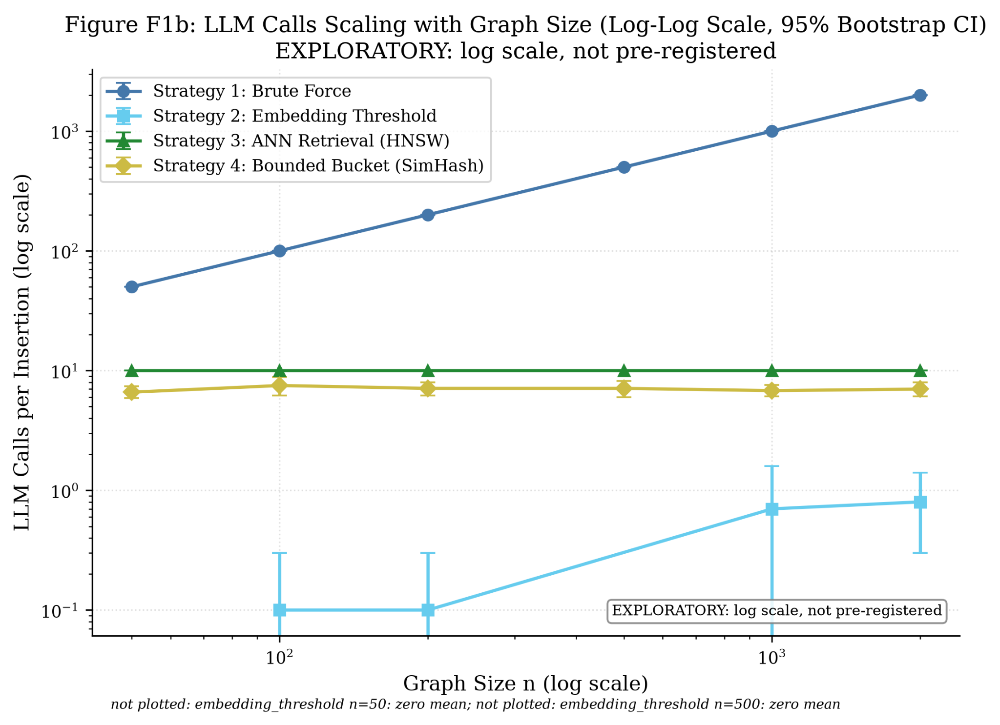

**Figure 4.6.** Log-scale companion F1b. It shows the same series as F1 on a logarithmic axis and replaces nothing.

**Answer to Research Question 1.** Under a single un-amortised insertion, cost grows approximately linearly with graph size for brute force (slope about 1), stays approximately flat for ANN retrieval and bounded-bucket partitioning (slopes within 0.03 of zero), and for embedding-threshold filtering depends on how many nodes pass the threshold: it grows roughly in proportion to n at θ = 0.4 and 0.5 but from a small base, and at the primary θ = 0.6 is too sparse for the pre-registered fit to be defined (at most 0.8 calls on average at n = 2000). Time follows calls.

## 4.3 Placement Accuracy (Research Question 2)

All accuracy claims come from the 12 accuracy runs on the two gold-standard graphs. Accuracy is reported per corpus (D4); the gold graphs supply only two sizes (29 and 141 nodes), so the question of accuracy against graph size can be answered only at those two sizes, and the two corpora differ in domain and density as well as size.

### 4.3.1 Primary Configurations

**Table 4.4:** Accuracy of the primary configurations (micro-averaged unless stated; one run each).

| **Corpus** | **Strategy** | **Calls** | **Precision** | **Recall** | **F1** | **Macro F1** | **Shortlist recall** | **Random baseline** |
|:---|----|----|----|----|----|----|----|----|
| DSA (29 trials) | S1 Brute force | 28.0 | 0.548 | 0.630 | **0.586** | 0.529 | 1.000 | n/a |
|  | S2 θ = 0.6 | 0.76 | 0.643 | 0.083 | 0.148 | 0.123 | 0.111 | n/a |
|  | S3 k = 10 | 10.0 | 0.639 | 0.426 | 0.511 | 0.444 | 0.528 | 0.357 |
|  | S4 (5, 10) | 6.97 | 0.594 | 0.176 | 0.271 | 0.217 | 0.259 | 0.357 |
| Metacademy (30 trials) | S1 Brute force | 140.0 | 0.081 | 0.624 | 0.143 | 0.145 | 1.000 | n/a |
|  | S2 θ = 0.6 | 1.13 | 0.594 | 0.174 | 0.270 | 0.175 | 0.202 | n/a |
|  | S3 k = 10 | 10.0 | 0.245 | 0.367 | **0.294** | 0.276 | 0.505 | 0.071 |
|  | S4 (5, 10) | 7.37 | 0.149 | 0.092 | 0.114 | 0.110 | 0.147 | 0.071 |

The ordering of strategies by F1 changes between corpora. On DSA the order is S1 (0.586), S3 (0.511), S4 (0.271), S2 (0.148). On Metacademy it is S3 (0.294), S2 (0.270), S1 (0.143), S4 (0.114). Three patterns explain most of this.

**Brute force over-links on the larger graph.** Strategy 1's recall is nearly the same on both corpora (0.630 and 0.624), but its precision falls from 0.548 to 0.081. With 140 candidates per insertion and few true prerequisites (about 6% of ordered pairs are positive in DSA and about 1.6% in Metacademy, computed from the counts in Section 3.2.1), the decision step labels many non-prerequisite pairs as prerequisites. The leave-one-out pilot on DSA (Section 3.3.6) found that 34 of its 58 false positives are implied by the transitive closure of the DSA gold graph, so precision on DSA is understated; that analysis is not repeated for Metacademy here, and the gold graphs are not transitively reduced (Section 3.2.1).

**Narrowing trades recall for precision.** Strategy 2 has the highest precision on DSA (0.643) and high precision on Metacademy (0.594) but very low recall (0.083 and 0.174), because its shortlist contains few of the true neighbours (shortlist recall 0.111 and 0.202): at θ = 0.6 most concepts have no candidate above the threshold and so reach no decision. Strategy 3 retains about half of the true neighbours in its shortlist (0.528 and 0.505) and obtains moderate precision and recall on both corpora.

**The decision step caps recall at the shortlist.** A true prerequisite that is not shortlisted cannot be recovered, and recall never exceeds shortlist recall in Table 4.4. The share of shortlisted true neighbours that the decision step labels correctly (recall divided by shortlist recall, computed) lies between 0.62 and 0.86 across all eight cells, so for every strategy a large part of the loss arises in the decision step itself, including direction errors, not only in narrowing.

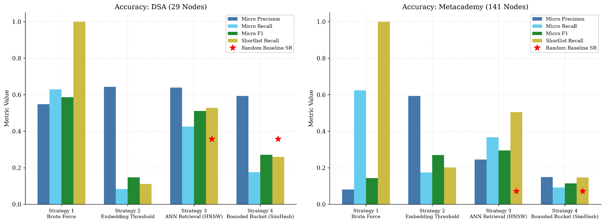

**Figure 4.7.** Accuracy by strategy and corpus (F4, redrawn from the F4 CSV for legibility; values unchanged). Red stars mark the random-baseline shortlist recall where defined.

### 4.3.2 Shortlist Recall Against the Random Baseline

The pre-registered baseline for a strategy with a shortlist cap draws min(k, m) distinct existing concepts at random from the m concepts present, giving expected shortlist recall min(k, m)/m, with k = s_max for Strategy 4. Strategy 3 is above this baseline on both corpora: 0.528 against 0.357 on DSA and 0.505 against 0.071 on Metacademy, about seven times higher on the larger graph (computed).

Strategy 4 is **below** the pre-registered baseline on DSA in all three bucket settings: 0.259 against 0.357 for (5, 10), 0.093 against 0.179 for (2, 5) and 0.593 against 0.714 for (10, 20). That comparison is generous to random selection, because Strategy 4's realised shortlists are smaller than s_max (6.97 calls on average against a cap of 10). Against a random draw of the same average size (6.97/28 = 0.249, computed), the primary configuration is about level (0.259), and the (10, 20) setting is above (0.593 against 0.509 for 14.24 candidates). On Metacademy Strategy 4 is above the pre-registered baseline in all three settings (0.147 against 0.071, 0.101 against 0.036, 0.220 against 0.143) and about 2.8 times above a size-matched draw for the primary setting (7.37/140 = 0.053). The conservative reading is that on DSA the bucket shortlist concentrates the true neighbours no better than random selection of the same size, while on Metacademy it does somewhat better. Each of these is a single run with no uncertainty interval, so small differences should not be taken as established.

### 4.3.3 Sensitivity Settings

**Table 4.5.** Micro-F1 and mean calls for the pre-specified one-at-a-time sensitivity settings (primary in bold).

| **Setting** | **DSA F1** | **DSA calls** | **Metacademy F1** | **Metacademy calls** |
|:---|----|----|----|----|
| S2 θ = 0.4 | 0.269 | 2.21 | 0.295 | 7.07 |
| S2 θ = 0.5 | 0.191 | 1.24 | 0.311 | 2.87 |
| **S2 θ = 0.6** | **0.148** | **0.76** | **0.270** | **1.13** |
| S3 k = 5 | 0.374 | 5.0 | 0.368 | 5.0 |
| **S3 k = 10** | **0.511** | **10.0** | **0.294** | **10.0** |
| S3 k = 20 | 0.569 | 20.0 | 0.266 | 20.0 |
| S3 efSearch = 64 | 0.484 | 10.0 | 0.297 | 10.0 |
| S3 efSearch = 256 | 0.506 | 10.0 | 0.293 | 10.0 |
| S4 (2, 5) | 0.102 | 3.10 | 0.100 | 3.30 |
| **S4 (5, 10)** | **0.271** | **6.97** | **0.114** | **7.37** |
| S4 (10, 20) | 0.486 | 14.24 | 0.148 | 15.93 |

Looser settings raise recall at the price of calls, but whether that raises F1 depends on the corpus. On DSA, F1 rises with the cap for Strategy 3 (0.374, 0.511, 0.569 for k = 5, 10, 20) and for Strategy 4 (0.102, 0.271, 0.486). On Metacademy, Strategy 3's F1 falls as k grows (0.368, 0.294, 0.266) because precision falls faster than recall rises (0.402, 0.245, 0.186), so the smallest setting scores highest there. For Strategy 2, loosening θ raises F1 on DSA (0.148, 0.191, 0.269 as θ goes 0.6 to 0.4) but on Metacademy the best value is at θ = 0.5 (0.311), within about 0.04 of the other two. The primary settings were fixed in advance and were not tuned on these results; the sensitivity table is a description of how much the conclusions depend on them, not a search for a better setting.

The efSearch variants return the same shortlist recall (0.528 on DSA, 0.505 on Metacademy), which suggests that the approximate index returned essentially the same neighbours at 64, 128 and 256. The F1 differences between them (at most about 0.028 on DSA, 0.004 on Metacademy) therefore arise in the decision step. That is the size of the single run-to-run difference noted in Section 4.1, so they should not be read as an effect of efSearch.

Counting the one pair that the DSA gold file leaves unjudged as a false positive (Table T4) changes the result in two cells only: Strategy 1 on DSA (F1 0.5862 to 0.5837) and Strategy 3 at k = 20 on DSA (0.5688 to 0.5662). The unjudged-pair choice does not affect any conclusion.

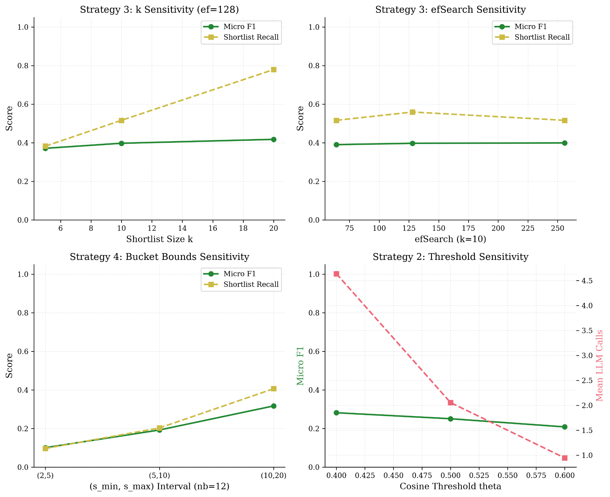

**Figure 4.8.** One-at-a-time sensitivity panels (F5).

**Answer to Research Question 2.** At the two sizes the gold graphs provide, F1 is lower on the 141-node Metacademy graph than on the 29-node DSA graph for Strategies 1, 3 and 4 (0.586 to 0.143, 0.511 to 0.294, 0.271 to 0.114) and higher for Strategy 2 (0.148 to 0.270). Because the corpora differ in domain and in the density of true edges as well as in size, this cannot be attributed to size alone. The clearest mechanism is the precision collapse of brute force when 140 candidates are judged one at a time.

## 4.4 Comparison of the Four Strategies (Research Question 3)

Figure 4.9 places each strategy's mean calls beside its micro-F1. Dominance is computed mechanically from the plotted points (D5): strategy A dominates B if it makes no more calls and has higher F1, with differences in F1 below 0.025 labelled "not distinguishable". The 0.025 margin is the one observed run-to-run difference in the plan, fixed before the sweep data was opened.

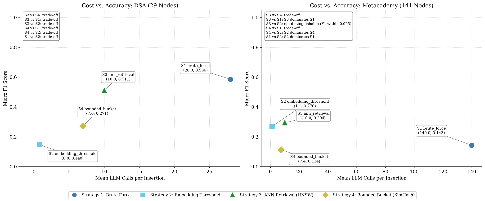

**Figure 4.9.** Cost beside accuracy with the dominance summary (F6, redrawn from the F6 CSV for legibility; points and text unchanged except that strategy names are abbreviated to S1 to S4). The log-scale version F6b is exploratory.

**Table 4.6:** Pairwise dominance (F6).

| **Corpus** | **Pair** | **ΔF1 (first minus second)** | **Result** |
|:---|----|----|----|
| DSA | S3 vs S4 | +0.240 | trade-off |
|  | S3 vs S1 | −0.075 | trade-off |
|  | S3 vs S2 | +0.364 | trade-off |
|  | S4 vs S1 | −0.315 | trade-off |
|  | S4 vs S2 | +0.124 | trade-off |
|  | S1 vs S2 | +0.439 | trade-off |
| Metacademy | S3 vs S4 | +0.181 | trade-off |
|  | S3 vs S1 | +0.151 | S3 dominates S1 |
|  | S3 vs S2 | +0.025 | not distinguishable (F1 within 0.025) |
|  | S4 vs S1 | −0.030 | trade-off |
|  | S4 vs S2 | −0.156 | S2 dominates S4 |
|  | S1 vs S2 | −0.126 | S2 dominates S1 |

On DSA every pair is a trade-off: the strategy with the highest F1 (brute force, 0.586) is also the most expensive (28 calls), and each cheaper strategy gives up F1. Brute force gains 0.075 F1 over Strategy 3 for 18 more calls. On Metacademy brute force is dominated outright: Strategies 3 and 2 make far fewer calls and score higher, so the largest graph reverses the DSA picture. Strategy 4 is dominated by Strategy 2 on Metacademy and is not dominant over any strategy on either corpus.

The comparison of Strategies 3 and 2 on Metacademy deserves a direct statement. Their F1 difference is 0.0246, which is 0.0004 below the 0.025 margin, so the label "not distinguishable" depends on that margin; a margin of 0.02 would label Strategy 3 higher. No interval has been computed for this difference, and none is claimed. Strategy 2 does it with 1.13 calls where Strategy 3 uses 10, but at a shortlist recall of 0.202 against 0.505 (Section 4.3.1).

Strategy 2's low call count is therefore a recall cost, not a free saving: it makes few calls because most insertions find no candidate above θ. Whether that is acceptable depends on the application's tolerance for missed relationships, which this study does not assess.

### 4.4.1 Classification and Ranking Against Pre-Declared Criteria (Post hoc)

Section 3.6 sets the gates and the ranking method. This subsection applies them to the primary configurations.

**Table 4.7:** Gate results and class (post hoc).

| **Strategy** | **G1: beats random baseline** | **G2: at most 50 calls at \$n = 2000\$** | **G3: not dominated** | **Class** |
|:---|----|----|----|----|
| S1 Brute force | Not applicable (full shortlist) | **Fail** (2,000 calls) | **Fail** on Metacademy (dominated by S3 and S2) | Not effective |
| S2 \$\theta = 0.6\$ | Not assessable (no cap) | Pass (0.8 calls) | Pass on both (trade-off on DSA; tied with S3 on Metacademy) | Conditionally effective |
| S3 \$k = 10\$ | Pass (0.528 vs 0.357; 0.505 vs 0.071) | Pass (10 calls) | Pass on both | **Effective** |
| S4 \$(5, 10)\$ | **Fail** on DSA (0.259 vs 0.357); pass on Metacademy (0.147 vs 0.071) | Pass (7.0 calls) | **Fail** on Metacademy (dominated by S2) | Not effective |

Only Strategy 3 passes every gate. Strategy 2 passes the gates that can be assessed, but its low call count comes largely from insertions that reach no decision (Section 4.4), and its shortlist recall is 0.111 and 0.202. Strategy 1 is the most accurate cell on DSA but fails the cost gate at \$n = 2000\$, and is dominated on Metacademy. Strategy 4 fails the baseline gate on DSA and is dominated on Metacademy. For G1 the pre-registered baseline is used; the size-matched comparison of Section 4.3.2 would put Strategy 4 about level with random on DSA (0.259 against 0.249), which does not change the class because G3 also fails.

**Absolute accuracy.** No cell meets the pilot's pass criteria (F1 at least 0.50 and recall at least 0.70). The only cell with F1 at least 0.50 and recall at least 0.50 is Strategy 1 on DSA (0.586, 0.630). Strategy 3 on DSA reaches F1 0.511 but recall 0.426, below the pilot's fail threshold, and on Metacademy its F1 is 0.294. The classification in Table 4.7 is therefore relative. Strategy 3 is the best available option, not one that reaches adequate accuracy on the larger graph by the pilot's own standard.

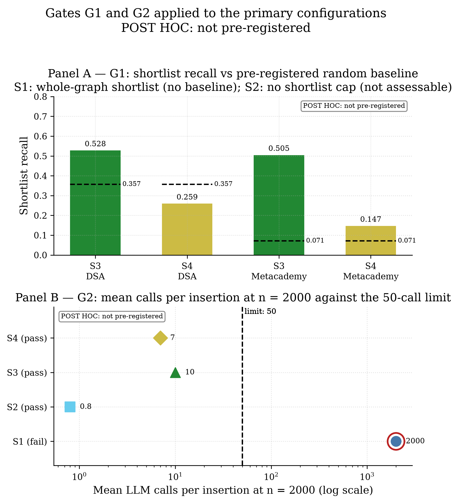

**Figure 4.11.** Gates G1 and G2 applied to the primary configurations (post hoc).

**Sensitivity of the classes to the gate settings (post hoc).** The classes in Table 4.7 do not change under the alternative settings examined here. For G2, the primary configurations make 0.8, 7.0, 10 and 2,000 calls at \$n = 2000\$ (Table 4.1), so any limit from 10 to 1,999 calls gives the same result for every strategy. For G1, Strategy 3 always returns 10 candidates, so its size-matched random baseline equals the pre-registered one and it exceeds either on both corpora. Strategy 4 is below the pre-registered baseline on DSA and about level with a size-matched one (0.259 against 0.249; Section 4.3.2), but its class is the same under either because it also fails G3. For G3, Strategy 1 and Strategy 4 are dominated on Metacademy for any margin up to 0.15 F1 (Table 4.6; Strategy 1 stops being dominated at 0.151 and Strategy 4 at 0.156, so the range is close to the limit), and no margin makes Strategy 2 or Strategy 3 dominated, because Strategy 2 makes the fewest calls on both corpora and the only strategy with a higher F1 than Strategy 3 (Strategy 1 on DSA) makes more calls.

**Table 4.8:** Rank on each single criterion (1 is best).

| **Strategy** | **F1 on DSA** | **F1 on Metacademy** | **Calls at \$n = 2000\$** | **Wall-clock at \$n = 2000\$** |
|:---|----|----|----|----|
| S1 | 1 | 3 | 4 | 4 |
| S2 | 4 | 2 | 1 | 1 |
| S3 | 2 | 1 | 3 | 3 |
| S4 | 3 | 4 | 2 | 2 |

Strategy 2 is cheapest on both cost measures and Strategy 1 is the most expensive. Strategy 4 is cheaper than Strategy 3 by about three calls but is less accurate on both corpora. The two cost rankings agree, as expected from Section 4.2.3.

**Table 4.9:** Weighted scores by scenario (higher is better; best per row in bold; post hoc).

| **Corpus** | **Scenario (accuracy / cost)** | **S1** | **S2** | **S3** | **S4** |
|:---|----|----|----|----|----|
| DSA | Accuracy-first (0.7 / 0.3) | **0.700** | 0.300 | 0.684 | 0.336 |
| DSA | Balanced (0.5 / 0.5) | 0.500 | 0.500 | **0.587** | 0.372 |
| DSA | Cost-first (0.3 / 0.7) | 0.300 | **0.700** | 0.491 | 0.407 |
| Metacademy | Accuracy-first | 0.116 | **0.905** | 0.883 | 0.202 |
| Metacademy | Balanced | 0.083 | **0.932** | 0.804 | 0.337 |
| Metacademy | Cost-first | 0.050 | **0.959** | 0.726 | 0.472 |

On DSA the top strategy changes with the weights: brute force when accuracy is weighted heavily, Strategy 3 when it is balanced, Strategy 2 when cost dominates. A single weighted ranking would therefore support different conclusions depending on the weights chosen. On Metacademy Strategy 2 leads in all three scenarios, with Strategy 3 second and the gap smaller when accuracy is weighted more.

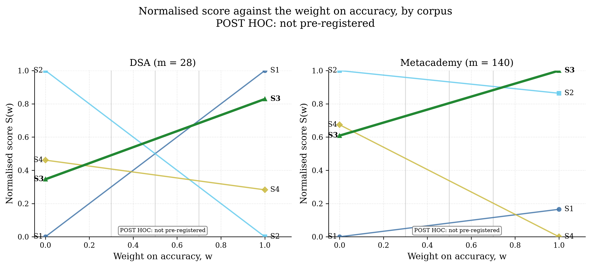

**Figure 4.12.** Normalised score against the weight on accuracy, by corpus (post hoc). Each line runs from a strategy's cost score at the left to its accuracy score at the right, so the leader at any weight is the highest line there.

**Table 4.10:** Share of weight draws giving each rank (accuracy weight uniform on 0 to 1; 20,000 draws; post hoc).

| **Corpus** | **Strategy** | **Rank 1** | **Rank 2** | **Rank 3** | **Rank 4** |
|:-----------|--------------|------------|------------|------------|------------|
| DSA        | S1           | 0.33       | 0.17       | 0.11       | 0.39       |
|            | S2           | 0.44       | 0.05       | 0.16       | 0.34       |
|            | S3           | 0.23       | 0.60       | 0.17       | 0.00       |
|            | S4           | 0.00       | 0.17       | 0.56       | 0.27       |
| Metacademy | S1           | 0.00       | 0.00       | 0.19       | 0.81       |
|            | S2           | 0.74       | 0.26       | 0.00       | 0.00       |
|            | S3           | 0.26       | 0.68       | 0.06       | 0.00       |
|            | S4           | 0.00       | 0.06       | 0.74       | 0.19       |

Strategy 3 is last in under 0.5% of draws on both corpora (rounded to 0.00 in the table) and is second most often on DSA (60%) and on Metacademy (68%). No other strategy has this property. Strategy 1 and Strategy 2 are first or last on DSA, depending on the weight. Strategy 4 is first in no draw on either corpus. Strategy 2's lead on Metacademy is a compensation effect, because it gains on cost what it lacks in recall (0.174), which is why it is read together with Table 4.7 and not from the score alone.

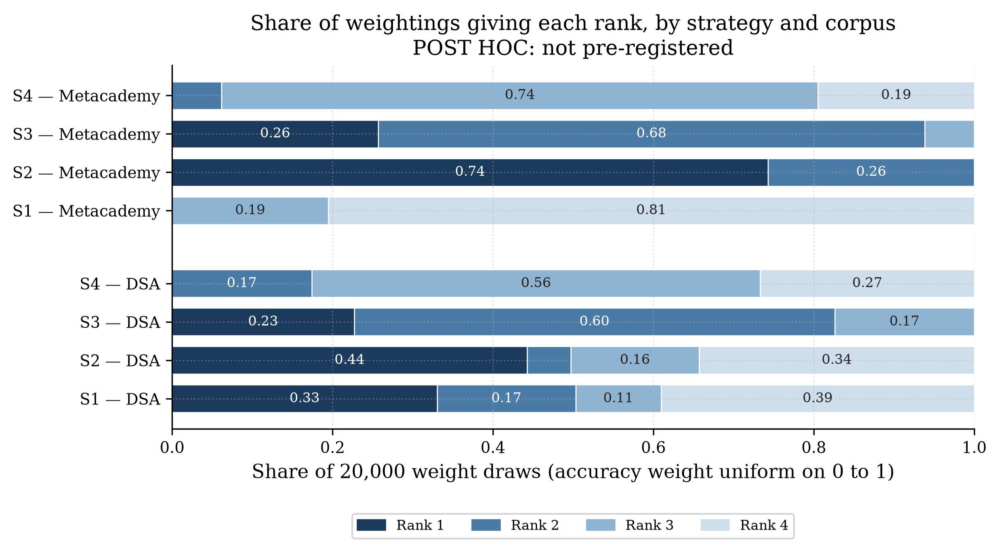

**Figure 4.13.** Share of weightings giving each rank, by strategy and corpus (post hoc). Segments under 8% are left unlabelled.

**Cross-checks (post hoc).** TOPSIS (Section 3.6.3) gives the same ranking as the weighted sum on Metacademy in all three scenarios (Kendall's τ-b = 1.00). On DSA it agrees in the balanced scenario (τ-b = 1.00, with Strategy 1 and Strategy 2 tied in both rankings) and differs by one adjacent swap in the other two (τ-b = 0.67). At accuracy-first, TOPSIS places Strategy 3 first (closeness 0.719) ahead of Strategy 1 (0.700), so the lead of brute force in Table 4.9 depends on the weighted-sum method. At cost-first, it places Strategy 4 ahead of Strategy 3. Replacing calls with mean wall-clock time at n = 2000 changes the leader in three of six cells, each time to Strategy 3 (DSA accuracy-first and cost-first; Metacademy accuracy-first). Strategy 3 stays in the top two in all six wall-clock cells and in five of six under TOPSIS (third on DSA cost-first). With four strategies τ-b takes few values, so no p-value is given (Table 4.11).

**Table 4.11:** Kendall's τ-b between the TOPSIS and weighted-sum rankings, by corpus and scenario (post hoc).

| **Corpus** | **Scenario**        | **τ-b** | **Tied pairs** |
|:-----------|---------------------|---------|----------------|
| DSA        | Accuracy-first      | 0.67    | 0              |
| DSA        | Balanced            | 1.00    | 1              |
| DSA        | Cost-first          | 0.67    | 0              |
| Metacademy | All three scenarios | 1.00    | 0              |

These results are post hoc, single-run, and rest on min-max scores over four strategies. They describe how these measurements order under the stated criteria. They do not show that the differences would persist in repeated runs.

**Answer to Research Question 3.** Under identical decision-step conditions, the four strategies differ enormously in cost (from 0.8 to 2,000 calls per insertion at \$n = 2000\$) and by up to 0.44 in F1 on DSA. Judged by the criteria of Section 3.6, Strategy 3 (ANN retrieval) is the only strategy classified effective: it beats the random baseline on both corpora, stays within the cost range of \[1\], and is not dominated on either corpus. It is also the strategy whose rank is most stable as the weights vary. Strategy 2 is conditionally effective: cheap and not dominated, but it cannot be tested against the baseline and its recall is low. Strategy 1 is the most accurate on DSA but is not effective, because it fails the cost gate and is dominated on Metacademy. Strategy 4 is not effective. On the absolute accuracy bar fixed in the pilot, no strategy passes, and Strategy 3 is best only in a relative sense on Metacademy (F1 0.294). Which strategy to prefer on DSA depends on how heavily accuracy is weighted.

## 4.5 Flatness of the Bucket-Capped Strategy (Research Question 4)

Research Question 4 asks whether the cost of one insertion under a bucket-capped strategy stays flat as the graph grows, as the structural premise of the amortised bound in the literature predicts. The study tests only this premise for a single un-amortised insertion; it does not test the amortised bound over a sequence of insertions.

Strategy 4's realised calls stay below its cap in every configuration: means of 6.6 to 7.5 against s_max = 10, with a largest single-trial count of 10; 2.7 to 3.2 against 5 for (2, 5), maximum 5; and 12.7 to 15.1 against 20 for (10, 20), maximum 20. Across a 40-fold increase in n (50 to 2000), neither calls nor wall-clock time grows. The fitted slopes are −0.0004 for calls and 0.0084 for wall-clock time (primary); 0.0033 and 0.0170 for (2, 5); and −0.0149 and −0.0193 for (10, 20) (−0.0296 on the clean post-hoc set). Every interval contains zero and every category is "approximately flat". The mean time per insertion stays between 5.15 and 5.77 seconds for the primary configuration, and the shortlist step takes about 0.01 seconds at every size.

The plan's own constraints on interpretation apply. Because the number of calls is bounded by s_max by construction, flat call counts are close to guaranteed, and the informative evidence is the wall-clock curve and the fact that realised counts sit below the cap. Strategy 3 is equally flat (calls constant at 10; wall-clock slope −0.0201), so flatness here is shown by both capped strategies and is not specific to bucket partitioning; their equal worst-case bound of 10 means the comparison does not isolate partitioning geometry from shortlist capacity (Section 3.3.5). No theoretical curve is overlaid, because the curves describe one insertion, not amortised behaviour (Section 3.5).

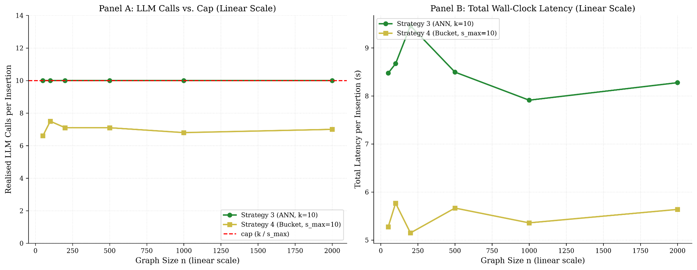

**Figure 4.10.** Premise check: calls and wall-clock time for Strategies 3 and 4 against n on a linear axis, with the cap as a reference line (F3).

**Answer to Research Question 4.** For single insertions into graphs of 50 to 2,000 nodes, the cost of the bucket-capped strategy did not grow with graph size, which is consistent with the premise that an insertion touches a bounded region of the graph. This is evidence for the premise only; it says nothing about amortised cost over many insertions.

## 4.6 Limits of These Results

- **One run per configuration, ten trials per size.** Run-to-run variation is not established. Two runs of the same DSA configuration differed by 0.025 micro-F1, which is the margin used in Figure 4.9. No result here is supported by a hypothesis test.

- **Timing from one laptop with no controlled load** (Intel i5-8250U, 4 cores, 8 threads). Latencies in the two Strategy 3 primary accuracy runs differed by up to 3.7 times for reasons not explained; accuracy-run latencies are not used for any cost claim. Retries and one peak-hour trial are reported in Section 4.2.4.

- **One decision-step model, one prompt, bare concept names.** Accuracy depends on the model's parametric knowledge, and the provider may change the model behind the alias.

- **Two gold corpora.** Accuracy at only two graph sizes, different in domain and density. The synthetic concept pool (Section 3.2.2) is unverified for pedagogical validity and is used for cost only.

- **Retrieval recall on the real corpora is not measured separately.** The recall figures of Section 3.3.4 (0.841, 0.968, 0.999 for efSearch 64, 128, 256) come from synthetic Gaussian vectors; here the observable is shortlist recall against gold neighbours (Tables 4.4 and 4.5).

- **Parameters.** No θ stricter than 0.6 was run, and M = 16 and efConstruction = 200 were fixed a priori.

- **Single un-amortised insertion.** The results do not describe sequential insertion or amortised cost.

- **Pipeline and accuracy-side choices.** Accuracy-mode summaries were seen before the plan was frozen (Section 4.1); validator and pipeline follow-ups accepted as known limits are recorded in the decision log (D-84(6)(f)).

- **Post-hoc classification and ranking.** The gates, thresholds and weights of Section 3.6 were specified after the results were available. The cost threshold comes from a different task \[1\], the accuracy criteria were set for brute force on DSA, and the scores depend on the set of four strategies and on single-run values. The classes are labels for these measurements, and the 22-to-50-call reference and the weight scenarios are conventions.

## 4.7 Summary of Findings

| **Research question** | **Finding** | **Where** |
|:---|----|----|
| RQ1 Cost vs n | Brute force grows about linearly (calls slope 1.0000; 1713 s at n = 2000). ANN retrieval and bounded buckets are flat in calls and wall-clock time. Embedding threshold grows with the number of passing nodes, from a small base; its primary θ = 0.6 fit is undefined. Time follows calls (about 0.8 to 0.9 s each). | 4.2, Tables 4.1 to 4.3 |
| RQ2 Accuracy vs n | At the two available sizes, F1 is lower on Metacademy for S1, S3, S4 and higher for S2; confounded with domain and density. Brute force over-links on Metacademy (precision 0.081). | 4.3, Tables 4.4, 4.5 |
| RQ3 Compare | DSA: all pairs trade off (best F1: S1 0.586 at 28 calls). Metacademy: S3 and S2 dominate S1; S3 vs S2 not distinguishable (ΔF1 0.0246); S2 dominates S4. Against the pre-declared gates (post hoc), only S3 is effective, S2 is conditionally effective, S1 and S4 are not; S3 is the most rank-stable under varying weights. No strategy meets the pilot's absolute accuracy criteria. | 4.4, 4.4.1, Tables 4.6 to 4.11 |
| RQ4 Bucket premise | Calls and time did not grow with n (slopes within 0.03 of zero); premise consistent for single insertions; amortised bound not tested. | 4.5 |

# **REFERENCES**

1.  R. Funk, S. Hosemann, J. C. Jung, and C. Lutz, "Towards ontology construction with language models," *arXiv preprint arXiv:2309.09898*, 2023.

2.  Y. Lairgi, L. Moncla, R. Cazabet, K. Benabdeslem, and P. Cléau, "iText2KG: Incremental knowledge graphs construction using large language models," in *Web Information Systems Engineering – WISE 2024*, Lecture Notes in Computer Science, Springer, 2024.

3.  H. Chen, X. Shen, Q. Lv, J. Wang, X. Ni, and J. Ye, "SAC-KG: Exploiting large language models as skilled automatic constructors for domain knowledge graph," in *Proc. 62nd Annu. Meeting Assoc. Comput. Linguistics (ACL 2024), Volume 1*: *Long Papers*, Bangkok, Thailand, Aug. 2024, pp. 4345–4360, doi: 10.18653/v1/2024.acl-long.238.

4.  F. Zhang, Z. Huang, Y. Zhou, Q. Guo, Z. Li, W. Luo, D. Jiang, Y. Fang, and X. Zhou, "EraRAG: Efficient and incremental retrieval augmented generation for growing corpora," *arXiv preprint arXiv:2506.20963*, 2025.

5.  W. Bao, Y. Wang, R. Gao, F. Leng, Y. Bao, and G. Yu, "DIAL-KG: Schema-free incremental knowledge graph construction via dynamic schema induction and evolution-intent assessment," *arXiv preprint arXiv:2603.20059*, 2026.

6.  M. C. Aytekin and Y. Saygın, "ACE: AI-assisted construction of educational knowledge graphs with prerequisite relations," *Journal of Educational Data Mining*, vol. 16, no. 2, pp. 85–114, 2024, doi: 10.5281/zenodo.14250896.

7.  M. C. Aytekin, "EKG-Dataset: All the datasets used in ACE: AI-assisted construction of educational knowledge graphs with prerequisite relations," GitHub repository. \[Online\]. Available: https://github.com/cemaytekin/EKG-Dataset

8.  B. Balilo, "Insights and trends of capstone project of CS/IT Department of Bicol University from 2011 to 2019," *International Journal of Computing Sciences Research*.

9.  A. A. A. Naguio and R. E. O. Roxas, "Multi-scale graph neural networks for knowledge graph completion in Philippine lexical resources," in Intelligent Computing, K. Arai and P. Lorenz, Eds., Lecture Notes in Networks and Systems, vol. 1949, Springer, Cham, 2026, pp. 846–865, doi: 10.1007/978-3-032-24804-6_48.

10. Yu. A. Malkov and D. A. Yashunin, "Efficient and robust approximate nearest neighbor search using Hierarchical Navigable Small World graphs," *IEEE Trans. Pattern Anal. Mach. Intell.*, vol. 42, no. 4, pp. 824–836, 2020, doi: 10.1109/TPAMI.2018.2889473.

11. J. Johnson, M. Douze, and H. Jégou, "Billion-scale similarity search with GPUs," *IEEE Trans. Big Data*, vol. 7, no. 3, pp. 535–547, 2021.

12. S. Kapoor, B. Stroebl, Z. S. Siegel, N. Nadgir, and A. Narayanan, "AI agents that matter," *Transactions on Machine Learning Research*, 2025, arXiv:2407.01502.

13. M. Aumüller, E. Bernhardsson, and A. Faithfull, "ANN-Benchmarks: A benchmarking tool for approximate nearest neighbor algorithms," *Information Systems*, vol. 87, 2020, arXiv:1807.05614.

14. M. Ehrgott, *Multicriteria Optimization*, 2nd ed. Springer, 2005.

15. C.-L. Hwang and K. Yoon, *Multiple Attribute Decision Making: Methods and Applications*. Springer, 1981.

16. R. T. Marler and J. S. Arora, "The weighted sum method for multi-objective optimization: new insights," *Structural and Multidisciplinary Optimization*, vol. 41, no. 6, pp. 853–862, 2010.

17. E. Triantaphyllou and A. Sánchez, "A sensitivity analysis approach for some deterministic multi-criteria decision-making methods," *Decision Sciences*, vol. 28, no. 1, pp. 151–194, 1997.

18. R. Lahdelma, J. Hokkanen, and P. Salminen, "SMAA: Stochastic multiobjective acceptability analysis," *European Journal of Operational Research*, vol. 106, no. 1, pp. 137–143, 1998.

19. H. A. Simon, "Rational choice and the structure of the environment," *Psychological Review*, vol. 63, no. 2, pp. 129–138, 1956.

20. E. Walker and A. S. Nowacki, "Understanding equivalence and noninferiority testing," *Journal of General Internal Medicine*, vol. 26, no. 2, pp. 192–196, 2011.

21. J. Han, M. Kamber, and J. Pei, *Data Mining: Concepts and Techniques*, 3rd ed. Morgan Kaufmann, 2012.

22. M. G. Kendall, "The treatment of ties in ranking problems," *Biometrika*, vol. 33, no. 3, pp. 239–251, 1945.
