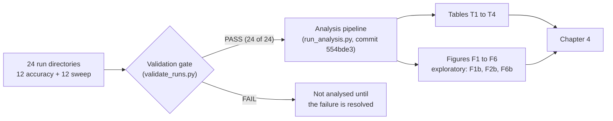
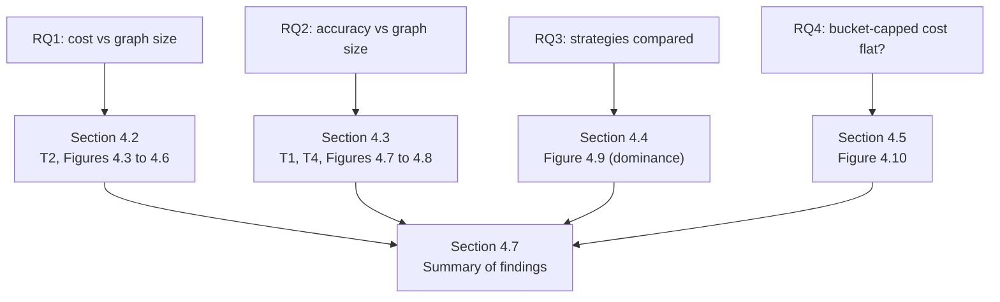
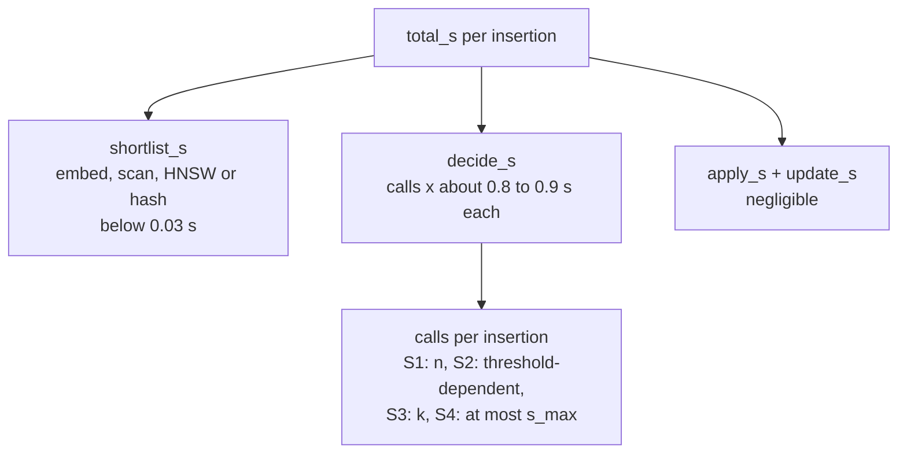

> **Drafting notes for Luke (delete before merging into the thesis file)**
> 1. Every number comes from Bundle B (`T1`, `T2_sweep_cost_summary`, `T2_slope_fits`, `T4`, `F6_dominance`, `RUN_INFO.txt`) or from the frozen plan. Values marked "computed" are my arithmetic on those tables.
> 2. Figure image paths are placeholders (`figures/...`); point them at your copies. F4, F6 and F6b use the `_redraw` files once the FIG-001 agent has produced them.
> 3. Two things I could not fill: the `exact_topk_overlap` summary (not in T1 to T4; D-35(5) says a low value for Strategy 4 at larger n is a finding; add one sentence in 4.3.5 if the pipeline outputs it), and the adviser's reconciliation of D2 and D3 (stated here as pending, as in the frozen plan).
> 4. Section 4.1 includes one sentence about the first draft of the pipeline. It states only what D-88 records. Keep or cut it as you see fit; do not add anything about what was or was not seen beyond that.
> 5. Mermaid blocks render in most Markdown viewers (GitHub, VS Code with a Mermaid extension, Obsidian). For Word or Google Docs, export each block to PNG at mermaid.live and insert it as the figure.

# Chapter 4: Presentation, Analysis, and Interpretation of Data

## 4.1 Overview and Reporting Conventions

This chapter presents the measurements collected under the experimental procedure of Chapter 3 and interprets them against the four research questions of Section 1.2. Section 4.2 reports cost scaling (Research Question 1), Section 4.3 reports placement accuracy (Research Question 2), Section 4.4 compares the four strategies on both measures (Research Question 3), and Section 4.5 examines whether the cost of one insertion under the bucket-capped strategy stays flat as the graph grows (Research Question 4). Section 4.6 sets out the limits of these results and Section 4.7 summarises them.

**Data collected.** The study comprises 24 runs: 12 accuracy-mode runs and 12 size-sweep runs, one run per configuration. The 12 configurations are the four primary strategy settings plus eight one-at-a-time sensitivity settings (Strategy 2 at θ = 0.4 and 0.5; Strategy 3 at k = 5 and 20 and at efSearch = 64 and 256; Strategy 4 at (s_min, s_max) = (2, 5) and (10, 20)). Each accuracy run has 59 trials (29 on the DSA graph and 30 on the Metacademy graph); each sweep run has 60 trials (10 at each of n = 50, 100, 200, 500, 1000, 2000). All 24 runs passed the validation gate: 20 passed outright and 4 passed as resumed runs (accuracy brute force, and sweep brute force, bounded bucket (10, 20) and embedding threshold at θ = 0.5), and no trial remained failed in any run (Table T3). Accuracy runs were executed at commit `3323bfb` and sweep runs at commit `ad81414`; the two commits are accepted under Amendment 2 of the analysis plan because the source files that affect results were unchanged between them. Tables and figures were generated at commit `554bde3` by a single script from data that had passed the gate, and an independent consistency check of the generated tables and figure data (3,399 checks) reported no failures.

**Statistics.** Cost and accuracy are described, not tested. For each strategy and size the chapter gives the mean (the headline wall-clock statistic, D6) with the median alongside, and 95% percentile bootstrap intervals over trials (10,000 resamples, fixed seed, D1). No hypothesis test is run between strategies, because each configuration is a single run, the decision-step model is not fully deterministic, and 10 trials per size is small. As one indication of run-to-run variation, two runs of the same DSA configuration differed by 0.025 micro-F1 (0.4859 against 0.5111); this is one observed difference, not an estimated noise floor. Scaling is summarised by the slope of an ordinary-least-squares fit of log(mean cost) on log(n) across the six sizes, with a bootstrap interval resampling trials within size. The flatness bins (slope below 0.1 "approximately flat", 0.1 to 0.9 "sub-linear", above 0.9 "approximately linear") are a convention chosen for this study, confirmed for the initial defense and subject to reconciliation with the adviser.

**Pre-registered, post-hoc and exploratory results.** The analysis plan was frozen before any sweep data was opened. Its Disclosure records that the accuracy-mode summaries had already been seen, so accuracy-side choices (per-corpus reporting and the 0.025 labelling margin in Figure 4.9) were not made blind. A first draft of the analysis pipeline was run on the real results before the final pipeline was accepted; the operator's recorded answer (D-88) is that he looked at its output, saw label overlaps, noticed no numbers or results, and requested no change because of it. Three groups of results added after the freeze (Amendment 3) are labelled wherever they appear: (i) slopes that are undefined because a size has zero mean cost, with an exploratory fit on positive-mean sizes; (ii) a timing sensitivity set that excludes retried trials and the single trial launched inside DeepSeek's peak window; (iii) the log-scale companion figures F1b, F2b and F6b. Nothing exploratory replaces a pre-registered result.

*Figure 4.1. From run directories to reported results. Only data that passed the gate reaches a table or figure.*

*Figure 4.2. Map from the research questions to the sections that answer them.*

## 4.2 Cost Scaling with Graph Size (Research Question 1)

All cost claims in this section come from the 12 sweep runs on the synthetic concept pool (Section 3.3.2). Each value is a mean over 10 single-insertion trials per size.

### 4.2.1 LLM Calls per Insertion

**Table 4.1. Mean LLM calls per insertion by graph size (sweep runs).**

| Strategy | n = 50 | 100 | 200 | 500 | 1000 | 2000 |
| --- | ---: | ---: | ---: | ---: | ---: | ---: |
| S1 Brute force | 50 | 100 | 200 | 500 | 1000 | 2000 |
| S2 Embedding threshold, θ = 0.6 (primary) | 0.0 | 0.1 | 0.1 | 0.0 | 0.7 | 0.8 |
| S2, θ = 0.5 | 0.0 | 0.3 | 0.6 | 1.3 | 2.5 | 3.0 |
| S2, θ = 0.4 | 0.2 | 0.6 | 1.0 | 4.3 | 7.8 | 13.5 |
| S3 ANN retrieval, k = 10 (primary) | 10 | 10 | 10 | 10 | 10 | 10 |
| S4 Bounded bucket, (5, 10) (primary) | 6.6 | 7.5 | 7.1 | 7.1 | 6.8 | 7.0 |

Strategy 1 makes one call per existing node, so its call count equals n and its log-log slope is 1.0000 (approximately linear). Strategy 3 makes exactly k = 10 calls at every size; its slope is zero and it prints as "0, constant" (the fitted value 6e-32 is floating-point noise on a constant series). Strategy 4's primary configuration averages 6.6 to 7.5 calls at every size, with a fitted slope of −0.0004 (95% CI −0.0433 to 0.0424), approximately flat.

Strategy 2 depends on how many existing nodes exceed the similarity threshold, so its calls grow with n at a low rate. At θ = 0.4 the pre-registered slope is 1.1535 (CI 0.9310 to 1.3880; 8,920 of 10,000 resamples were usable), classified approximately linear, but the level is small: 13.5 calls at n = 2000, about 0.7% of the 2,000 existing nodes, and between 0.4% and 0.9% of n at every size (computed). Slope describes growth rate, not magnitude. At θ = 0.5 and θ = 0.6 the pre-registered fit is **undefined**, because some sizes have zero mean calls (θ = 0.5 at n = 50; θ = 0.6 at n = 50 and n = 500) and a log-log fit needs positive means; the plan forbids clamping. Following Amendment 3 these two cases receive no flatness category. An **exploratory** fit on the positive-mean sizes gives slopes of 0.7966 (CI 0.4482 to 1.2109; 9,666 usable resamples) for θ = 0.5 and 0.8095 (CI 0.2689 to 0.9538; only 4,123 usable resamples) for θ = 0.6. Because the bootstrap conditions on positive draws, these intervals are optimistic in one direction. For θ = 0.6 the counts in Table 4.1 are the evidence; the slope should not be quoted without them.

### 4.2.2 Wall-Clock Time per Insertion

**Table 4.2. Mean wall-clock time per insertion (`total_s`, seconds) by graph size.**

| Strategy | n = 50 | 100 | 200 | 500 | 1000 | 2000 |
| --- | ---: | ---: | ---: | ---: | ---: | ---: |
| S1 Brute force | 58.63 | 68.43 | 168.35 | 357.57 | 860.11 | 1713.10 |
| S2 θ = 0.6 (primary) | 0.013 | 0.153 | 0.081 | 0.014 | 0.623 | 0.938 |
| S2 θ = 0.5 | 0.012 | 0.319 | 0.390 | 1.471 | 2.167 | 2.843 |
| S2 θ = 0.4 | 0.288 | 0.517 | 0.712 | 9.387 | 6.457 | 11.318 |
| S3 k = 10 (primary) | 8.476 | 8.673 | 9.461 | 8.497 | 7.912 | 8.277 |
| S4 (5, 10) (primary) | 5.272 | 5.769 | 5.149 | 5.666 | 5.358 | 5.638 |

**Table 4.3. Log-log slope of mean cost against n (pre-registered unless stated; 95% bootstrap CI).**

| Strategy (configuration) | Calls slope | Wall-clock slope | Category (wall-clock) |
| --- | --- | --- | --- |
| S1 | 1.0000 | 0.9605 (0.8472 to 1.0624), R² 0.982 | approximately linear |
| S2 θ = 0.4 | 1.1535 (0.9310 to 1.3880) | 1.0997 (0.8670 to 1.7737) | approximately linear |
| S2 θ = 0.5 | undefined (exploratory 0.7966) | 1.3017 (1.0961 to 1.5963) | approximately linear |
| S2 θ = 0.6 (primary) | undefined (exploratory 0.8095) | 0.8771 (0.5570 to 1.3271), R² 0.461 | sub-linear |
| S3 k = 10 (primary) | 0 (constant) | −0.0201 (−0.0324 to −0.0079) | approximately flat |
| S4 (5, 10) (primary) | −0.0004 (−0.0433 to 0.0424) | 0.0084 (−0.0321 to 0.0488) | approximately flat |

Three readings of Table 4.3 need care. First, Strategy 3's wall-clock interval (−0.0324 to −0.0079) excludes zero, so "approximately flat" holds by the D2 threshold (|slope| < 0.1), not because the interval contains zero; the same is true of its efSearch = 256 (0.0154) and k = 20 (0.0123) variants. The slope has magnitude about 0.02 across a 40-fold increase in n, and the mean fluctuates between 7.9 and 9.5 seconds with no monotone trend. Second, Strategy 2 at θ = 0.6 has a wall-clock R² of only 0.461: most trials make no LLM call and take about 0.01 seconds, while the few that do take about a second each, so the six size means mostly reflect how many trials happened to call. Its "sub-linear" label is a weak description and the means in Table 4.2 are more informative. Third, Strategy 1's all-trials slope (0.9605) lies below 1 partly because of retry delay at n = 50 (Section 4.2.4); a post-hoc set that excludes retried trials gives 1.0558 (CI 1.0439 to 1.0677, R² 0.998). Both support "approximately linear".

At n = 2000 one brute-force insertion takes 1713 seconds on average, against 8.28 seconds for Strategy 3 and 5.64 for Strategy 4, about 207 and 304 times longer (computed).

### 4.2.3 Time Follows the Number of Calls

The shortlist step (embedding the new concept, the similarity scan, the HNSW search or the hashing) is negligible everywhere: below 0.03 seconds for every Strategy 2, 3 and 4 configuration and below 0.001 seconds for brute force. Wall-clock time is therefore the decision step, and the decision step is the number of calls times the per-call latency. Dividing the mean time at n = 2000 by the mean calls gives 0.857 s per call for Strategy 1 (1713.1 / 2000), 0.828 for Strategy 3 (8.277 / 10), 0.805 for Strategy 4 (5.638 / 7.0) and 0.838 for Strategy 2 at θ = 0.4 (11.318 / 13.5) (computed). The strategies differ in cost almost entirely because they make different numbers of calls, not because their narrowing steps differ in speed.

*Figure 4.5. Where the time of one insertion goes. Per-call latency is similar across strategies, so calls determine cost.*

### 4.2.4 Retries and the Peak-Hour Trial (Post-hoc Sensitivity)

`total_s` includes backoff time for retried trials. Brute force at n = 50 averages 58.63 seconds over all 10 trials but 35.75 seconds when its one retried trial (maximum 264.52 s) is excluded; at n = 200 the values are 168.35 and 156.86 seconds; at n = 2000 they are 1713.10 and 1709.89. Strategy 2 at θ = 0.4 and n = 500 averages 9.39 seconds, or 3.53 seconds without its one retried trial. One sweep trial (`sweep:brute_force:2000:t9`) was launched with peak hours allowed and ran inside DeepSeek's peak window; the n = 2000 brute-force times range from 1669.5 to 1763.7 seconds (standard deviation 31.7 s), and with ten trials per size no claim is made about an effect of peak hours. Excluding retried trials and that trial changes no flatness category (Strategy 1: 1.0558; Strategy 2 at θ = 0.4: 1.0543 against 1.0997; Strategy 4 at (10, 20): −0.0296 against −0.0193). These runs were also resumed after interruptions, and Strategy 1 and Strategy 2 were first run at sizes 50 to 500 and then extended to all six sizes before analysis, without changing the design (Amendment 3, point 2). Table T3 lists the resumed runs and the counts of failed-then-succeeded trials, none of which is imputed or dropped from the pre-registered results.

**Answer to Research Question 1.** Under a single un-amortised insertion, cost grows approximately linearly with graph size for brute force (slope about 1), stays approximately flat for ANN retrieval and bounded-bucket partitioning (slopes within 0.03 of zero), and for embedding-threshold filtering depends on how many nodes pass the threshold: it grows roughly in proportion to n at θ = 0.4 and 0.5 but from a small base, and at the primary θ = 0.6 is too sparse for the pre-registered fit to be defined (at most 0.8 calls on average at n = 2000). Time follows calls.

## 4.3 Placement Accuracy (Research Question 2)

All accuracy claims come from the 12 accuracy runs on the two gold-standard graphs. Accuracy is reported per corpus (D4); the gold graphs supply only two sizes (29 and 141 nodes), so the question of accuracy against graph size can be answered only at those two sizes, and the two corpora differ in domain and density as well as size.

### 4.3.1 Primary Configurations

**Table 4.4. Accuracy of the primary configurations (micro-averaged unless stated; one run each).**

| Corpus | Strategy | Calls | Precision | Recall | F1 | Macro F1 | Shortlist recall | Random baseline |
| --- | --- | ---: | ---: | ---: | ---: | ---: | ---: | ---: |
| DSA (29 trials) | S1 Brute force | 28.0 | 0.548 | 0.630 | **0.586** | 0.529 | 1.000 | n/a |
| | S2 θ = 0.6 | 0.76 | 0.643 | 0.083 | 0.148 | 0.123 | 0.111 | n/a |
| | S3 k = 10 | 10.0 | 0.639 | 0.426 | 0.511 | 0.444 | 0.528 | 0.357 |
| | S4 (5, 10) | 6.97 | 0.594 | 0.176 | 0.271 | 0.217 | 0.259 | 0.357 |
| Metacademy (30 trials) | S1 Brute force | 140.0 | 0.081 | 0.624 | 0.143 | 0.145 | 1.000 | n/a |
| | S2 θ = 0.6 | 1.13 | 0.594 | 0.174 | 0.270 | 0.175 | 0.202 | n/a |
| | S3 k = 10 | 10.0 | 0.245 | 0.367 | **0.294** | 0.276 | 0.505 | 0.071 |
| | S4 (5, 10) | 7.37 | 0.149 | 0.092 | 0.114 | 0.110 | 0.147 | 0.071 |

The ordering of strategies by F1 changes between corpora. On DSA the order is S1 (0.586), S3 (0.511), S4 (0.271), S2 (0.148). On Metacademy it is S3 (0.294), S2 (0.270), S1 (0.143), S4 (0.114). Three patterns explain most of this.

**Brute force over-links on the larger graph.** Strategy 1's recall is nearly the same on both corpora (0.630 and 0.624), but its precision falls from 0.548 to 0.081. With 140 candidates per insertion and few true prerequisites (about 6% of ordered pairs are positive in DSA and about 1.6% in Metacademy, computed from the counts in Section 3.3.1), the decision step labels many non-prerequisite pairs as prerequisites. The leave-one-out pilot on DSA (Section 3.2.6) found that 34 of its 58 false positives are implied by the transitive closure of the DSA gold graph, so precision on DSA is understated; that analysis is not repeated for Metacademy here, and the gold graphs are not transitively reduced (Section 3.3.1).

**Narrowing trades recall for precision.** Strategy 2 has the highest precision on DSA (0.643) and high precision on Metacademy (0.594) but very low recall (0.083 and 0.174), because its shortlist contains few of the true neighbours (shortlist recall 0.111 and 0.202): at θ = 0.6 most concepts have no candidate above the threshold and so reach no decision. Strategy 3 retains about half of the true neighbours in its shortlist (0.528 and 0.505) and obtains moderate precision and recall on both corpora.

**The decision step caps recall at the shortlist.** A true prerequisite that is not shortlisted cannot be recovered, and recall never exceeds shortlist recall in Table 4.4. The share of shortlisted true neighbours that the decision step labels correctly (recall divided by shortlist recall, computed) lies between 0.62 and 0.86 across all eight cells, so for every strategy a large part of the loss arises in the decision step itself, including direction errors, not only in narrowing.

### 4.3.2 Shortlist Recall Against the Random Baseline

The pre-registered baseline for a strategy with a shortlist cap draws min(k, m) distinct existing concepts at random from the m concepts present, giving expected shortlist recall min(k, m)/m, with k = s_max for Strategy 4. Strategy 3 is above this baseline on both corpora: 0.528 against 0.357 on DSA and 0.505 against 0.071 on Metacademy, about seven times higher on the larger graph (computed).

Strategy 4 is **below** the pre-registered baseline on DSA in all three bucket settings: 0.259 against 0.357 for (5, 10), 0.093 against 0.179 for (2, 5) and 0.593 against 0.714 for (10, 20). That comparison is generous to random selection, because Strategy 4's realised shortlists are smaller than s_max (6.97 calls on average against a cap of 10). Against a random draw of the same average size (6.97/28 = 0.249, computed), the primary configuration is about level (0.259), and the (10, 20) setting is above (0.593 against 0.509 for 14.24 candidates). On Metacademy Strategy 4 is above the pre-registered baseline in all three settings (0.147 against 0.071, 0.101 against 0.036, 0.220 against 0.143) and about 2.8 times above a size-matched draw for the primary setting (7.37/140 = 0.053). The conservative reading is that on DSA the bucket shortlist concentrates the true neighbours no better than random selection of the same size, while on Metacademy it does somewhat better. Each of these is a single run with no uncertainty interval, so small differences should not be taken as established. [Add the `exact_topk_overlap` summary here if available.]

### 4.3.3 Sensitivity Settings

**Table 4.5. Micro-F1 and mean calls for the pre-specified one-at-a-time sensitivity settings (primary in bold).**

| Setting | DSA F1 | DSA calls | Metacademy F1 | Metacademy calls |
| --- | ---: | ---: | ---: | ---: |
| S2 θ = 0.4 | 0.269 | 2.21 | 0.295 | 7.07 |
| S2 θ = 0.5 | 0.191 | 1.24 | 0.311 | 2.87 |
| **S2 θ = 0.6** | **0.148** | **0.76** | **0.270** | **1.13** |
| S3 k = 5 | 0.374 | 5.0 | 0.368 | 5.0 |
| **S3 k = 10** | **0.511** | **10.0** | **0.294** | **10.0** |
| S3 k = 20 | 0.569 | 20.0 | 0.266 | 20.0 |
| S3 efSearch = 64 | 0.484 | 10.0 | 0.297 | 10.0 |
| S3 efSearch = 256 | 0.506 | 10.0 | 0.293 | 10.0 |
| S4 (2, 5) | 0.102 | 3.10 | 0.100 | 3.30 |
| **S4 (5, 10)** | **0.271** | **6.97** | **0.114** | **7.37** |
| S4 (10, 20) | 0.486 | 14.24 | 0.148 | 15.93 |

Looser settings raise recall at the price of calls, but whether that raises F1 depends on the corpus. On DSA, F1 rises with the cap for Strategy 3 (0.374, 0.511, 0.569 for k = 5, 10, 20) and for Strategy 4 (0.102, 0.271, 0.486). On Metacademy, Strategy 3's F1 falls as k grows (0.368, 0.294, 0.266) because precision falls faster than recall rises (0.402, 0.245, 0.186), so the smallest setting scores highest there. For Strategy 2, loosening θ raises F1 on DSA (0.148, 0.191, 0.269 as θ goes 0.6 to 0.4) but on Metacademy the best value is at θ = 0.5 (0.311), within about 0.04 of the other two. The primary settings were fixed in advance and were not tuned on these results; the sensitivity table is a description of how much the conclusions depend on them, not a search for a better setting.

The efSearch variants return the same shortlist recall (0.528 on DSA, 0.505 on Metacademy), which suggests that the approximate index returned essentially the same neighbours at 64, 128 and 256. The F1 differences between them (at most about 0.028 on DSA, 0.004 on Metacademy) therefore arise in the decision step. That is the size of the single run-to-run difference noted in Section 4.1, so they should not be read as an effect of efSearch.

Counting the one pair that the DSA gold file leaves unjudged as a false positive (Table T4) changes the result in two cells only: Strategy 1 on DSA (F1 0.5862 to 0.5837) and Strategy 3 at k = 20 on DSA (0.5688 to 0.5662). The unjudged-pair choice does not affect any conclusion.

**Answer to Research Question 2.** At the two sizes the gold graphs provide, F1 is lower on the 141-node Metacademy graph than on the 29-node DSA graph for Strategies 1, 3 and 4 (0.586 to 0.143, 0.511 to 0.294, 0.271 to 0.114) and higher for Strategy 2 (0.148 to 0.270). Because the corpora differ in domain and in the density of true edges as well as in size, this cannot be attributed to size alone. The clearest mechanism is the precision collapse of brute force when 140 candidates are judged one at a time.

## 4.4 Comparison of the Four Strategies (Research Question 3)

Figure 4.9 places each strategy's mean calls beside its micro-F1. Dominance is computed mechanically from the plotted points (D5): strategy A dominates B if it makes no more calls and has higher F1, with differences in F1 below 0.025 labelled "not distinguishable". The 0.025 margin is the one observed run-to-run difference in the plan, fixed before the sweep data was opened.

**Table 4.6. Pairwise dominance (F6).**

| Corpus | Pair | ΔF1 (first minus second) | Result |
| --- | --- | ---: | --- |
| DSA | S3 vs S4 | +0.240 | trade-off |
| | S3 vs S1 | −0.075 | trade-off |
| | S3 vs S2 | +0.364 | trade-off |
| | S4 vs S1 | −0.315 | trade-off |
| | S4 vs S2 | +0.124 | trade-off |
| | S1 vs S2 | +0.439 | trade-off |
| Metacademy | S3 vs S4 | +0.181 | trade-off |
| | S3 vs S1 | +0.151 | S3 dominates S1 |
| | S3 vs S2 | +0.025 | not distinguishable (F1 within 0.025) |
| | S4 vs S1 | −0.030 | trade-off |
| | S4 vs S2 | −0.156 | S2 dominates S4 |
| | S1 vs S2 | −0.126 | S2 dominates S1 |

On DSA every pair is a trade-off: the strategy with the highest F1 (brute force, 0.586) is also the most expensive (28 calls), and each cheaper strategy gives up F1. Brute force gains 0.075 F1 over Strategy 3 for 18 more calls. On Metacademy brute force is dominated outright: Strategies 3 and 2 make far fewer calls and score higher, so the largest graph reverses the DSA picture. Strategy 4 is dominated by Strategy 2 on Metacademy and is not dominant over any strategy on either corpus.

The comparison of Strategies 3 and 2 on Metacademy deserves a direct statement. Their F1 difference is 0.0246, which is 0.0004 below the 0.025 margin, so the label "not distinguishable" depends on that margin; a margin of 0.02 would label Strategy 3 higher. No interval has been computed for this difference, and none is claimed. Strategy 2 does it with 1.13 calls where Strategy 3 uses 10, but at a shortlist recall of 0.202 against 0.505 (Section 4.3.1).

Strategy 2's low call count is therefore a recall cost, not a free saving: it makes few calls because most insertions find no candidate above θ. Whether that is acceptable depends on the application's tolerance for missed relationships, which this study does not assess.

**Answer to Research Question 3.** Under identical decision-step conditions, the four strategies differ enormously in cost (from 0.8 to 2,000 calls per insertion at n = 2000) and by up to 0.44 in F1 (DSA). No strategy is best on both measures on DSA. On Metacademy, ANN retrieval and embedding thresholding dominate brute force and cannot be separated from each other, and bounded-bucket partitioning is dominated by embedding thresholding.

## 4.5 Flatness of the Bucket-Capped Strategy (Research Question 4)

Research Question 4 asks whether the cost of one insertion under a bucket-capped strategy stays flat as the graph grows, as the structural premise of the amortised bound in the literature predicts. The study tests only this premise for a single un-amortised insertion; it does not test the amortised bound over a sequence of insertions.

Strategy 4's realised calls stay below its cap in every configuration: means of 6.6 to 7.5 against s_max = 10, with a largest single-trial count of 10; 2.7 to 3.2 against 5 for (2, 5), maximum 5; and 12.7 to 15.1 against 20 for (10, 20), maximum 20. Across a 40-fold increase in n (50 to 2000), neither calls nor wall-clock time grows. The fitted slopes are −0.0004 for calls and 0.0084 for wall-clock time (primary); 0.0033 and 0.0170 for (2, 5); and −0.0149 and −0.0193 for (10, 20) (−0.0296 on the clean post-hoc set). Every interval contains zero and every category is "approximately flat". The mean time per insertion stays between 5.15 and 5.77 seconds for the primary configuration, and the shortlist step takes about 0.01 seconds at every size.

The plan's own constraints on interpretation apply. Because the number of calls is bounded by s_max by construction, flat call counts are close to guaranteed, and the informative evidence is the wall-clock curve and the fact that realised counts sit below the cap. Strategy 3 is equally flat (calls constant at 10; wall-clock slope −0.0201), so flatness here is shown by both capped strategies and is not specific to bucket partitioning; their equal worst-case bound of 10 means the comparison does not isolate partitioning geometry from shortlist capacity (Section 3.2.5). No theoretical curve is overlaid, because the curves describe one insertion, not amortised behaviour (Section 3.5).

**Answer to Research Question 4.** For single insertions into graphs of 50 to 2,000 nodes, the cost of the bucket-capped strategy did not grow with graph size, which is consistent with the premise that an insertion touches a bounded region of the graph. This is evidence for the premise only; it says nothing about amortised cost over many insertions.

## 4.6 Limits of These Results

- **One run per configuration, ten trials per size.** Run-to-run variation is not established. Two runs of the same DSA configuration differed by 0.025 micro-F1, which is the margin used in Figure 4.9. No result here is supported by a hypothesis test.
- **Timing from one laptop with no controlled load** (Intel i5-8250U, 4 cores, 8 threads). Latencies in the two Strategy 3 primary accuracy runs differed by up to 3.7 times for reasons not explained; accuracy-run latencies are not used for any cost claim. Retries and one peak-hour trial are reported in Section 4.2.4.
- **One decision-step model, one prompt, bare concept names.** Accuracy depends on the model's parametric knowledge, and the provider may change the model behind the alias.
- **Two gold corpora.** Accuracy at only two graph sizes, different in domain and density. The synthetic concept pool (Section 3.3.2) is unverified for pedagogical validity and is used for cost only.
- **Retrieval recall on the real corpora is not measured separately.** The recall figures of Section 3.2.4 (0.841, 0.968, 0.999 for efSearch 64, 128, 256) come from synthetic Gaussian vectors; here the observable is shortlist recall against gold neighbours (Tables 4.4 and 4.5).
- **Parameters.** No θ stricter than 0.6 was run, and M = 16 and efConstruction = 200 were fixed a priori.
- **Single un-amortised insertion.** The results do not describe sequential insertion or amortised cost.
- **Pipeline and accuracy-side choices.** Accuracy-mode summaries were seen before the plan was frozen (Section 4.1); validator and pipeline follow-ups accepted as known limits are recorded in the decision log (D-84(6)(f)).

## 4.7 Summary of Findings

| Research question | Finding | Where |
| --- | --- | --- |
| RQ1 Cost vs n | Brute force grows about linearly (calls slope 1.0000; 1713 s at n = 2000). ANN retrieval and bounded buckets are flat in calls and wall-clock time. Embedding threshold grows with the number of passing nodes, from a small base; its primary θ = 0.6 fit is undefined. Time follows calls (about 0.8 to 0.9 s each). | 4.2, Tables 4.1 to 4.3 |
| RQ2 Accuracy vs n | At the two available sizes, F1 is lower on Metacademy for S1, S3, S4 and higher for S2; confounded with domain and density. Brute force over-links on Metacademy (precision 0.081). | 4.3, Tables 4.4, 4.5 |
| RQ3 Compare | DSA: all pairs trade off (best F1: S1 0.586 at 28 calls). Metacademy: S3 and S2 dominate S1; S3 vs S2 not distinguishable (ΔF1 0.0246); S2 dominates S4. | 4.4, Table 4.6 |
| RQ4 Bucket premise | Calls and time did not grow with n (slopes within 0.03 of zero); premise consistent for single insertions; amortised bound not tested. | 4.5 |
